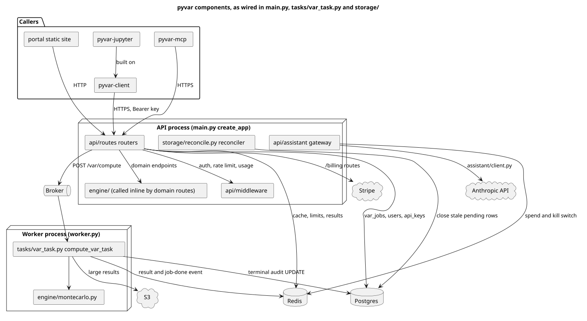

# pyvar documentation set

Generated documentation for the repository at `/workspace/src`, a risk-computation platform whose own README describes it as an "open-source financial and risk management computation platform" (`README.md:3`). Every statement in these documents names the file and line it came from, and anything the source did not settle is marked "not determined from the source".

## Documents

| Document | Read it for |
|---|---|
| [architecture-overview.md](architecture-overview.md) | how the API, worker, engine, storage and AWS stacks fit together |
| [api-reference.md](api-reference.md) | routes, authentication, request and response models, status codes, quotas |
| [api-domain-endpoints.md](api-domain-endpoints.md) | the 385 per-function endpoints of the eight compute domains |
| [onboarding-guide.md](onboarding-guide.md) | setup, a first call, where code lives, tests, rules |

## Diagrams

Each diagram has a source file and a rendered file with the same name in `diagrams/`.

| Diagram | Source and rendering | Grounded in |
|---|---|---|
| Components | `diagrams/component-architecture.puml`, `.svg` | `main.py`, `tasks/var_task.py`, `storage/`, `assistant/README.md` |
| AWS stacks | `diagrams/aws-deployment.puml`, `.svg` | `pyvar-cdk/app.py:50-231` |
| Use cases (inferred from routes and the README, not stated in the source) | `diagrams/use-cases-inferred.puml`, `.svg` | `api/routes/`, `README.md` |
| VaR job sequence | `diagrams/var-job-sequence.mmd`, `.svg` | `api/routes/var.py:179-452`, `tasks/var_task.py:358-444` |
| Data model | `diagrams/data-model.mmd`, `.svg` | `storage/models.py:44-314` |
| Tier transitions | `diagrams/tier-transitions.mmd`, `.svg` | `api/tiers.py:161-187`, `api/routes/billing.py:51-57`, `api/routes/internal.py:176-235` |
| Credential kinds | `diagrams/credential-kinds.mmd`, `.svg` | `api/middleware/auth.py:13-142`, `CLAUDE.md:219-260` |

## Scope and limits

The repository has 1,331 files and about 295,000 lines (`docugen-src manifest`). These documents cover the application code paths that define the API, the job pipeline, the data model, the tiers, the infrastructure entry point and the contributor workflow. They do not describe the numerical content of the 385 engine functions, the `docs/` planning notes in the source, the portal pages or the plugin skills beyond naming them. The repository's own `docs/` directory holds many plans and reports; the ones this set relied on are named in each document's Sources section.

## Sources

README.md
CLAUDE.md
main.py
api/routes/var.py
api/routes/billing.py
api/routes/internal.py
api/middleware/auth.py
api/tiers.py
storage/models.py
tasks/var_task.py
assistant/README.md
pyvar-cdk/app.py
