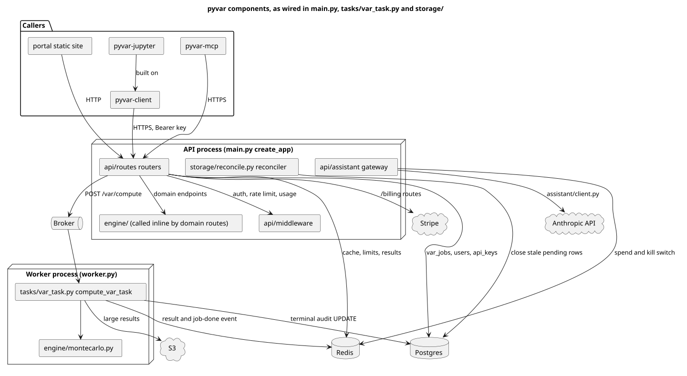
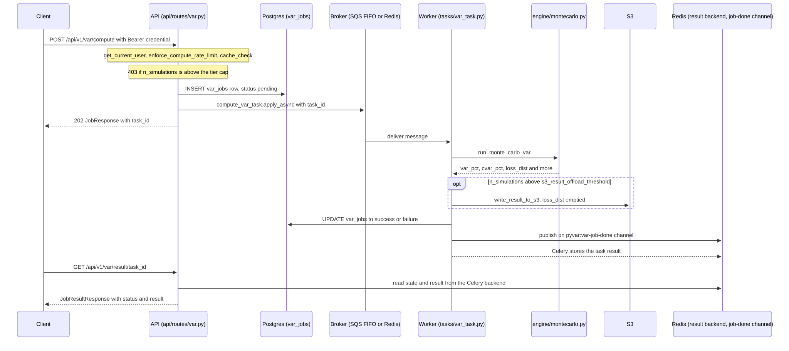
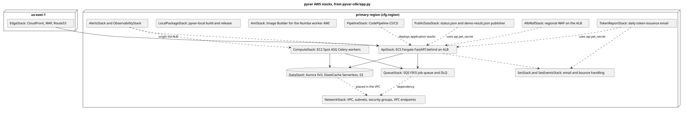

# pyvar architecture overview

pyvar.com is described by its README as an "open-source financial and risk management computation platform" built by Fibtec Limited (UK) on NumPy and Numba (`README.md:3-5`). It exposes 385 risk functions across 8 domains as a REST API, and runs Monte Carlo VaR as an asynchronous job pipeline (`README.md:12-15`). This document describes how the code in the repository is put together. Statements carry a `path:line` reference. Where the source does not settle a question, the text says "not determined from the source".

## 1. Shape of the system

The repository holds one Python application (an API process and a Celery worker built from the same image), the compute engine, AWS CDK infrastructure, a static web portal, and four client packages.

| Part | Where | What it does |
|---|---|---|
| API process | `main.py`, `api/` | FastAPI app built by `create_app()` (`main.py:150-280`). Serves the REST API, the static portal and the assistant answer bank. |
| Worker process | `worker.py`, `tasks/var_task.py` | Celery worker that runs the Monte Carlo VaR job (`worker.py:33-43`, `tasks/var_task.py:358-364`). |
| Compute engine | `engine/` | Pure compute modules, grouped by file-name prefix (see section 5). |
| Request and response models | `schemas/` | Pydantic v2 models, one module per domain plus `var.py`, `auth.py`, `billing.py`, `assistant.py`, `internal.py`. |
| Persistence | `storage/`, `migrations/` | SQLAlchemy ORM (`storage/models.py`), Redis helper (`storage/redis_client.py`), S3 writer (`storage/s3.py`), Alembic migrations 0001 to 0010 (`migrations/versions/`). |
| Observability | `observability/` | Prometheus, Sentry and structlog set-up, called from `create_app()` (`main.py:165`). |
| Portal assistant | `assistant/`, `api/assistant/` | Guarded question answering over the function catalogue (section 7). |
| Infrastructure | `pyvar-cdk/` | AWS CDK app with 16 stacks (`pyvar-cdk/app.py:50-209`). |
| Clients | `pyvar-client/`, `pyvar-jupyter/`, `plugins/mcp/`, `plugins/*/SKILL.md` | Python SDK, notebook magics, an MCP server and one Claude Code skill per domain. |
| Offline and self-hosted builds | `pyvar-local/`, `pyvar-full/` | An engine-only image with a CLI, and the full stack under `docker compose` (`pyvar-local/README.md:3-26`, `pyvar-full/README.md:3-25`). |
| Portal | `portal/` | Static HTML, CSS and JS. `portal/functions.json` is named the canonical function list (`README.md:17-19`). |

## 2. The API process

`create_app()` builds the application in this order (`main.py:150-280`):

1. A `FastAPI` object with `OrjsonResponse` as the default response class, docs at `/docs` and `/redoc`, and a `lifespan` handler (`main.py:151-159`).
2. A 422 handler that stays renderable when a rejected value is NaN or Infinity (`main.py:162`).
3. Observability set-up, then resolution of the Stripe secrets at startup (`main.py:165`, `main.py:171`).
4. The usage-tracking HTTP middleware, then CORS with an explicit per-environment origin list and no credentialed CORS (`main.py:175`, `main.py:188-193`).
5. Routers, all under the prefix `cfg.api_v1_prefix`, whose default is `/api/v1` (`config.py:29`): auth, billing, internal, var, eight domain routers, trial, assistant (`main.py:196-246`). The public-data router has no prefix (`main.py:251`).
6. `GET /health`, hidden from the schema (`main.py:254-256`).
7. A static mount for the assistant answer bank at `/assistant/bank` (`main.py:263-267`).
8. The portal, mounted last at `/` through `_PortalStaticMount`, a `Mount` subclass that returns no match for reserved API prefixes, so a wrong-method request to a real route gets that route's own 405 or 404 instead of a static-file 404 (`main.py:66-98`, `main.py:276-278`).

### Startup and shutdown

The `lifespan` handler (`main.py:101-147`):

- refuses to run a hosted environment on the public default signing secret (`main.py:106`, `config.py:541`);
- warms the Numba JIT with a 1,000-path run so the first request does not pay the compile cost (`main.py:108-116`);
- in hosted environments only, runs every whitelisted trial function once (`main.py:118-124`) and starts the `var-jobs-reconciler` background task (`main.py:126-137`);
- on shutdown, cancels the reconciler and closes the shared job-done subscriber (`main.py:141-147`).

`HOSTED_ENVS` is `{"dev", "staging", "prod", "production"}` (`config.py:19`).

### Two ways a computation runs

| Path | Used by | How |
|---|---|---|
| Inline | the eight domain routers (385 endpoints) and the trial lane | The endpoint is an `async def` that calls the engine synchronously (`api/routes/trial.py:15-18`). The trial lane runs it in one worker thread per API task with a one-second deadline (`api/routes/trial.py:15-25`). |
| Queued job | `POST /api/v1/var/compute` | Audit row, then Celery dispatch, then 202 with a `task_id` (`api/routes/var.py:179-331`). |

Every domain router gets `enforce_compute_rate_limit` as a router-level dependency (`main.py:222-234`). The VaR router applies it only on `POST /compute`, because the same router also serves the cheap result poll (`api/routes/var.py:189-193`).

## 3. The VaR job pipeline

1. **Submit.** `submit_var` checks the tier's simulation cap and returns 403 above it (`api/routes/var.py:213-224`). Pro and education accounts also have a monthly simulation quota enforced through the limiter (`api/routes/var.py:233-256`). The route is wrapped in `cache_check(domain="var")`, so an identical request may be answered with 200 and a cached result (`api/routes/var.py:184-188`, `api/routes/var.py:195`; cache design in `api/routes/caching.py:1-41`).
2. **Audit first.** A `var_jobs` row with status `pending` is inserted before dispatch. If that insert fails the job is not dispatched and the caller gets 503 (`api/routes/var.py:262-286`).
3. **Dispatch.** `compute_var_task.apply_async` is called with the same `task_id`. If dispatch fails, the audit row is marked `failure` and the caller gets 503 (`api/routes/var.py:289-320`). The route returns 202 with a `JobResponse` (`api/routes/var.py:328-331`). It also emits a `job-submitted-{env}` CloudWatch metric that the worker auto-scaling group uses for scale-from-zero (`api/routes/var.py:111-135`, `api/routes/var.py:326`).
4. **Run.** The Celery app is named `pyvar`, with broker and backend taken from `CELERY_BROKER_URL` and `CELERY_RESULT_BACKEND` and a fallback to `cfg.redis_url` (`tasks/var_task.py:267-271`). Settings that matter: `task_acks_late=True`, `task_reject_on_worker_lost=True`, `worker_prefetch_multiplier=1` and `worker_max_tasks_per_child=100` (`tasks/var_task.py:278-291`). The task is `pyvar.tasks.compute_var` with `max_retries=2` (`tasks/var_task.py:358-363`). On SQS each message is published in its own message group, `MessageGroupId` equal to the task id, so a FIFO queue does not serialise all jobs (`tasks/var_task.py:314-352`).
5. **Offload.** Above `s3_result_offload_threshold` simulations (default 10,000, `config.py:158`) the worker writes the result to S3 and empties `loss_dist` (`tasks/var_task.py:420-423`).
6. **Finish.** The worker does a best-effort UPDATE of the `var_jobs` row to its terminal state (`tasks/var_task.py:138-200`) and publishes a completion event. The result is read back through the Celery result backend (`api/routes/var.py:363-379`).
7. **Reconcile.** A row still `pending` after `var_jobs_pending_timeout_seconds` (an hour by default, per the module note) is marked `failure` by the reconciler that runs inside each hosted API task (`storage/reconcile.py:1-21`).

### Streaming results

`WS /api/v1/var/stream/{task_id}` pushes the result when the job finishes. The socket takes its credential as `?token=`, and an API key is never accepted there because URLs are logged (`api/routes/var.py:751-808`). A client exchanges a key or session for a 60-second one-task token with `POST /api/v1/var/stream-token/{task_id}` (`api/routes/var.py:713-748`). Each API process holds one shared Redis Pub/Sub connection (`_JobDoneBus`, `api/routes/var.py:515`) on channels named `pyvar:var-job-done:{task_id}` (`api/routes/var.py:504-505`). A pushed message only wakes the handler; the handler re-reads the authoritative state (`api/routes/var.py:775-786`). Open sockets are capped per process and per user (`api/routes/var.py:468-499`).

## 4. Authentication, tiers and limits

`api/middleware/auth.py` accepts two bearer credentials on ordinary routes (`api/middleware/auth.py:13-18`):

- a **session JWT**, valid 60 minutes, whose tier comes from its claims;
- a **durable API key** beginning `pyvar_`, whose tier is read from the database and briefly cached.

Three narrower tokens carry an `aud` claim, which makes `decode_token_payload` refuse them on every other route: the stream token (`pyvar-stream`), the admin token (`pyvar-admin`) and the trial ticket (`pyvar-trial`) (`api/middleware/auth.py:45-48`, `api/middleware/auth.py:100-118`, `CLAUDE.md:238-244`).

### Tier table

`api/tiers.py` is the single table of tier limits (`api/tiers.py:1-29`). Known tiers are `free`, `pro`, `enterprise`, `internal`, `trial` and `education` (`api/tiers.py:46`). Numbers visible in the source:

| Tier | Max simulations per request | Daily compute requests | Source |
|---|---|---|---|
| free | 10,000 | `rate_limit_free_daily`, default 20 | `api/tiers.py:79-87`, `config.py:180` |
| pro | 100,000 | `rate_limit_pro_daily`, default 500, plus monthly caps | `api/tiers.py:88-96`, `config.py:181` |
| enterprise | 500,000 | none (exempt) | `api/tiers.py:97-105` |
| internal | 500,000 | none (exempt) | `api/tiers.py:108-116` |
| education | 100,000 | from settings, plus a burst cap and monthly caps | `api/tiers.py:119-128` |
| trial | 10,000 | 5 | `api/tiers.py:133-141` |

An unknown tier gets the free limits and a one-time warning (`api/tiers.py:145-158`). `effective_tier()` turns an education grant into `free` once `tier_expires_at` has passed or the feature flag is off (`api/tiers.py:161-187`).

Only two Stripe events change a tier: `checkout.session.completed` moves a free or education account to `pro`, and `customer.subscription.deleted` moves a `pro` account to `free`. A failed payment and a monthly cap do not (`api/routes/billing.py:51-57`).

### Rate limiting

`api/middleware/rate_limit.py` builds a plain FastAPI dependency around `slowapi`'s Redis-backed limiter and gives every compute endpoint the same fixed scope, so the quota is one account-wide bucket instead of one per endpoint (`api/middleware/rate_limit.py:24-30`). Redis is shared with Celery and the cache so all Fargate tasks count together (`api/middleware/rate_limit.py:7-13`).

Failure behaviour differs by component:

| Component | If Redis or storage fails | Source |
|---|---|---|
| Compute rate limits | fail open (allow) | `api/middleware/rate_limit.py:48-52` |
| API-key cache | falls back to the database | `CLAUDE.md:227-230` |
| API-key database lookup | 503, never a pass | `CLAUDE.md:228-229` |
| Trial lane budgets | fail closed, lane off | `CLAUDE.md:245-248`, `api/routes/trial.py:9-14` |
| Assistant spend cap | fails closed | `api/middleware/rate_limit.py:72-73` |

## 5. The compute engine

`engine/` holds the compute modules. File-name prefixes follow the API domains: `alm_`, `credit_`, `deriv_`, `liquidity_`, `oprisk_`, `portfolio_`, `reg_`, plus cross-cutting modules such as `montecarlo.py`, `var_models.py`, `volatility.py`, `greeks.py`, `stress.py`, `frtb.py`, `expected_shortfall.py`, `backtesting.py` and `pnl_attribution.py` (directory listing of `engine/`).

The VaR kernel is `engine/montecarlo.py`:

- `_simulate_paths` is `@njit(parallel=True, cache=True)` and loops with `prange` over simulations (`engine/montecarlo.py:21-49`);
- random shocks are drawn in pure Python before the JIT region, with an optional antithetic mode (`engine/montecarlo.py:52-72`);
- `run_monte_carlo_var` returns VaR, CVaR, the full sorted loss distribution, fitted mean and volatility, and echoes the request parameters (`engine/montecarlo.py:75-145`). The sort runs in NumPy outside the JIT region because it measured faster (`engine/montecarlo.py:121-125`).

The project's own Numba rules (stateless kernels, float64 only, pre-drawn randomness, `cache=True` with `prange`, NumPy-only returns, warm-up in the lifespan handler) are in `CLAUDE.md:128-159` and repeated in `CONTRIBUTING.md:49-74`.

## 6. Data model

| Table | Model | Purpose | Source |
|---|---|---|---|
| `users` | `User` | Accounts: tier, optional tier expiry, e-mail and verification, suppression flags, Stripe customer id | `storage/models.py:90-161` |
| `api_keys` | `ApiKey` | Durable keys; only the SHA-256 is stored; revoking sets `revoked_at` | `storage/models.py:164-197` |
| `var_jobs` | `VaRJob` | Append-only audit log of every VaR job; index on `(user_id, created_at)` | `storage/models.py:200-254` |
| `billing_events` | `BillingEvent` | Audit trail of every tier change; `stripe_event_id` makes webhooks idempotent | `storage/models.py:257-314` |
| `api_usage` | `ApiUsage` | Operational telemetry, safe to prune, no user identifier | `storage/models.py:44-87` |

Only `api_keys.user_id` is a real foreign key. `var_jobs.user_id` and `billing_events.user_id` hold `users.external_id` as a plain string (`storage/models.py:219`, `storage/models.py:270-273`).

`var_jobs` and `billing_events` are audit logs kept six years, and only `api/audit_retention.py` may delete them (`CLAUDE.md:191-200`, `storage/models.py:200-209`). Schema changes go through Alembic, never `create_all()` (`CLAUDE.md:184-186`).

## 7. Trial lane and portal assistant

**No-sign-up trial lane.** Three routes, `POST /trial/challenge`, `/trial/ticket` and `/trial/run/{function}`, give a proof-of-work-gated ticket that can run whitelisted functions inline (`api/routes/trial.py:1-14`, `api/routes/trial.py:272`, `api/routes/trial.py:305`, `api/routes/trial.py:378`). `api/trial_whitelist.py` carries the whitelist and `api/trial_examples.json` carries one example body per function (`CLAUDE.md:89-90`). Refusals for a switched-off lane, a spent budget, a used-up ticket, a busy task or a bad proof of work all share one 429 `trial_exhausted` body, while malformed requests keep their own status (`api/routes/trial.py:9-14`).

**Assistant.** `POST /api/v1/assistant/ask` is the typed-question gateway, off by default through `assistant_typed_enabled` (`config.py:267`, `api/assistant/routes.py:6-9`). The pipeline is `assistant/guardrails.py::answer_question`: scrub, tool loop, grade, one retry, then static text (`assistant/README.md:18`). Only `assistant/client.py` imports `anthropic` (`assistant/README.md:13`). A separate answer bank of pre-written answers is built by `python -m assistant.bank build` and served as static files (`assistant/README.md:22-33`, `main.py:263-267`).

## 8. Deployment

`pyvar-cdk/app.py` instantiates the stacks and declares their dependencies (`pyvar-cdk/app.py:50-231`). `EdgeStack` is deployed to `us-east-1` while the rest use the primary region (`pyvar-cdk/app.py:43-44`, `pyvar-cdk/app.py:149-157`). The README summarises the core as Aurora and ElastiCache and S3 for data, SQS FIFO for jobs, EC2 Spot for workers, ECS Fargate behind an ALB for the API, and CloudFront with WAF at the edge (`README.md:93-102`, `README.md:208-217`). The pipeline stack is CodePipeline and self-mutating (`pyvar-cdk/app.py:50-56`).

The `Dockerfile` has a `builder` and a `runtime` stage, runs as user `pyvar`, exposes 8000 and defines a healthcheck (`Dockerfile:46`, `Dockerfile:109`, `Dockerfile:146-152`). The same image runs the API and the worker. For local work `docker-compose.yml` defines `pyvar-api`, `pyvar-api-dev` (dev profile), `worker`, `redis`, `postgres` and `flower` (monitoring profile) (`docker-compose.yml:34`, `:75`, `:114`, `:147`, `:163`, `:182`).

CI (`.github/workflows/ci.yml`) runs on pull requests to `master` and `develop` with five jobs: lint (black, isort, ruff), Bandit, tests on Python 3.11 and 3.12 with an 80% coverage floor, a CDK synth check and a Docker build (`ci.yml:16-18`, `:33`, `:64`, `:83-139`, `:148`, `:182`). Further workflows publish `pyvar-client`, `pyvar-jupyter` and `pyvar-mcp`, and build `pyvar-local` (`.github/workflows/` listing).

## 9. Cross-cutting behaviour

- **Usage telemetry.** One `api_usage` row per `/api/v1` request, written by a fire-and-forget task after the response; the `X-Pyvar-Client` header is matched against an allowlist and is never tied to a user (`api/middleware/usage.py:1-25`). Trial refusals leave no row (`api/middleware/usage.py:49-60`).
- **Result cache.** Redis, keyed by SHA-256 of the canonical request JSON, all errors treated as a miss (`api/routes/caching.py:7-19`).
- **Client IP.** Behind CloudFront and the ALB, the trusted client IP is the second-to-last `X-Forwarded-For` entry (`api/middleware/rate_limit.py:35-47`).
- **Secrets.** Secrets come from AWS Secrets Manager, never hard-coded (`CLAUDE.md:206-207`).

## 10. Known gaps and discrepancies

- The README layout lists portal mock-ups `portal/pyvar_portal.html`, `pyvar_market_risk.html` and `pyvar_architecture.html` (`README.md:80-83`). They do not appear in the `portal/` directory listing; the portal holds `index.html`, `dashboard.html`, `domain-*.html` and others.
- The README says 385 functions (`README.md:12`). Path declarations in the eight domain router modules number 385 by `docugen-src grep`. `api/middleware/rate_limit.py:14-18` and `main.py:219` say 386 endpoints in total, which matches 385 plus `POST /var/compute`.
- Not determined from the source: the full list of settings in `config.py` (searched for specific names, not read in full), the behaviour of `ui/app.py` (Streamlit dashboard), `ingestion/` internals, the contents of `scripts/`, and the validation suite under `tests/validation/`.

## Sources

README.md
CLAUDE.md
CONTRIBUTING.md
main.py
worker.py
config.py
Dockerfile
docker-compose.yml
api/tiers.py
api/routes/var.py
api/routes/trial.py
api/routes/billing.py
api/routes/caching.py
api/assistant/routes.py
api/middleware/auth.py
api/middleware/rate_limit.py
api/middleware/usage.py
engine/montecarlo.py
storage/models.py
storage/reconcile.py
tasks/var_task.py
assistant/README.md
pyvar-cdk/app.py
pyvar-local/README.md
pyvar-full/README.md
.github/workflows/ci.yml
