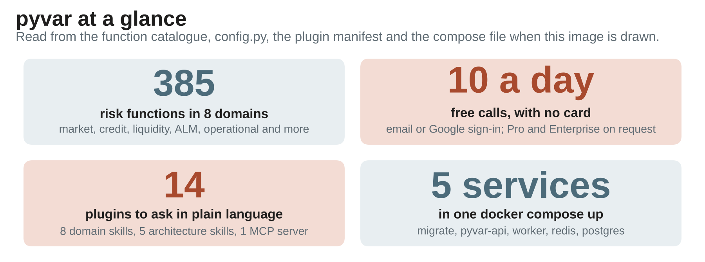
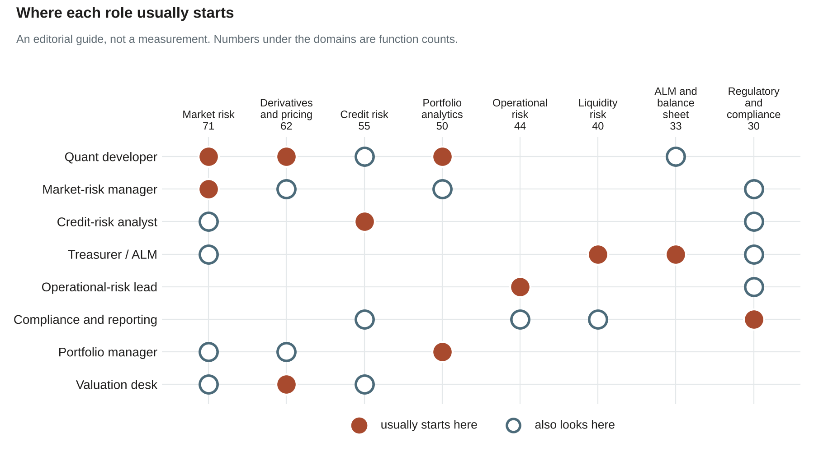

# 385 Risk Functions, One Open-Source API: What pyvar Does, and for Whom

*From a five-line VaR call to a Basel IV output floor, pyvar puts the numbers a risk function is asked for behind one API that anyone can read, rerun and check. A tour for the engineers who build with it and the finance people who sign off on what comes out.*



---

It is four in the afternoon, and two people in the same bank need the same kind of thing.

**The engineer** has been asked for the one-day 99% VaR and the FRTB 97.5% Expected Shortfall on a ten-million book, to be rerun tomorrow with the same answer.

**The finance lead** has a supervisor asking how the interest-rate-risk number in the pack was produced, and would like to show the formula, not a vendor's PDF.

It is one question in two accents: *can I see how this number was made, and can I make it again?* pyvar is built so that the answer is yes.

pyvar is an open-source (Apache-2.0) API with **385 risk functions in eight domains**: market risk, derivatives, credit, portfolio analytics, operational risk, liquidity, ALM and regulatory capital. Every function is a plain call with plain inputs, every regulatory constant is a line of code you can search for, and the same call works from `curl`, from Python, from a notebook, or from a plain-language request to Claude.

![The pyvar logo and "pyvar at a glance": 385 risk functions in 8 domains; 14 plugins to ask in plain language (8 domain skills, 5 architecture skills, 1 MCP server); 5 services in one docker compose up (migrate, pyvar-api, worker, redis, postgres). Below, what each plan allows: Free, 10 calls a day and 10,000 simulations per request; Pro, 500 calls a day, 5,000 calls and 2,000,000 simulations a month and 100,000 simulations per request; Enterprise, no cap on calls a day and 500,000 simulations per request. A Pro account that reaches a monthly cap moves to Free until its next billing date. Pro and Enterprise: write to info@pyvar.com.](./assets/overview/at-a-glance.png)

*pyvar at a glance, and what each plan allows. Every number is read from the code when the image is drawn.*

**How to read this.** The paragraphs are for everyone. Code appears under a bold "For engineers" line, followed by a screenshot of the same call in the Try it panel on pyvar.com, so if you sign off on numbers rather than write the code, skip those. Every worked number below comes from a real run on synthetic inputs with fixed seeds, so your team can reproduce it.

## Eight desks, one API


*The whole catalogue, with one question per domain.*

The catalogue covers the frameworks a European or UK risk function lives with: Basel III and IV, FRTB (standardised and internal-model approaches), IRRBB, IFRS 9, CRR2, ICAAP and ILAAP, EMIR, SFTR, MiFID II, Solvency II, UCITS and AIFMD.



*Where each role usually starts. An editorial guide, not a measurement.*

If you recognise your role, the next four questions are your fastest way in.

## Four questions, with real numbers

### "How much can we lose tomorrow, and is the model any good?"

Two years of daily returns on a 10-million book go in. Out come the Basel one-day 99% VaR, **238,046** (2.38% of the book), and the FRTB 97.5% Expected Shortfall, **245,467**, the average of the 13 worst days out of 500. Expected Shortfall is the mean of the losses beyond the threshold, not a quantile, so the response also says how many days sit in that tail.

Then the part a model-validation team cares about. On a 250-day window a 99% VaR should be breached about 2.5 times. Here it was breached 7 times: the Basel traffic light says **yellow**, the capital multiplier is **3.65**, and the Kupiec test **rejects** the model (a likelihood ratio of 5.50 against a critical value of 3.84, p = 0.019). Three calls take a breach count to a verdict a supervisor would recognise.

**For engineers.**

```python
from pyvar_client import Client

with Client() as client:  # reads PYVAR_API_KEY
    result = client.market_risk.historical_simulation_var(
        returns=returns,  # 500 daily log-returns
        portfolio_value=10_000_000,
        confidence_level=0.99,
    )
print(result["var_abs"], result["cvar_abs"])  # 238045.72 290838.34
```

The returns are synthetic, `generate_gbm_returns(500, mu=0.0004, sigma=0.011, seed=7)` from the repository's fixtures, which is why the figures repeat exactly.


*The same call in the Try it panel of the Market Risk page on pyvar.com. The key is masked.*

### "What will defaults cost us, and how much capital sits behind that?"

A 50-million exposure with a 2% probability of default and a 45% loss given default has an expected loss of **450,000**, 0.9% of the exposure. That is the price of the risk. The Vasicek single-factor model gives the loss that capital must absorb at 99.9%: **3,967,401**, which leaves an **unexpected loss of 3,517,401** on top of the expected loss. The first number belongs in pricing; the second is what economic capital has to cover.

**For engineers.**

```python
with Client() as client:
    el = client.credit_risk.expected_loss_el_computation(pd=0.02, lgd=0.45, ead=50_000_000)
    var = client.credit_risk.credit_var_analytical_vasicek(
        pd=0.02, lgd=0.45, ead_total=50_000_000,
        asset_correlation=0.15, confidence_level=0.999,
    )
print(el["el"], var["var"], var["ul"])  # 450000.0 3967401.130789 3517401.130789
```


*The Vasicek call in the Try it panel of the Credit Risk page; the expected-loss call has a panel of its own.*

### "Can we get through a bad fortnight, and what does a rate shock do to us?"

With 120 million of high-quality liquid assets against 110 million of net 30-day outflows, the **LCR is 109.1%**; the **NSFR is 106.5%** (410 million of available stable funding over 385 million required). Both read compliant. Then the harder question: with a 100-million buffer and net outflows that follow a 12-day stress path, the buffer **survives 10 full days and is exhausted during day 11**.

On the interest-rate side, a cash-flow ladder is shocked the six standard BCBS ways. The worst case, a parallel rise, costs **81.9 million of economic value**, **9.1% of the 900 million of Tier 1 capital**, under the 15% supervisory outlier test.

**For engineers.**

```bash
curl -X POST https://www.pyvar.com/api/v1/liquidity/survival_horizon_calculator \
  -H "Authorization: Bearer $PYVAR_API_KEY" -H "Content-Type: application/json" \
  -d '{"hqla": 100000000,
       "daily_net_outflows": [8e6, 9e6, 11e6, 12e6, 12e6, 10e6, 9e6, 8e6, 8e6, 7e6, 7e6, 6e6]}'
# {"survival_days": 10, "terminal_buffer": -1000000.0, "hqla": 100000000.0}
```


*The same function in the Try it panel of the Liquidity Risk page, which takes the 12-day outflow path as a list.*

### "Do we clear the ratios, and does the Basel IV floor bite?"

CET1 capital of 5.2 billion on 41 billion of risk-weighted assets is a **12.68% ratio**, 8.18 points over the 4.5% minimum. Stacking the conservation, countercyclical and systemic buffers gives a combined requirement of 4.5%, which is 1.845 billion of capital, and a leverage ratio of 3.63% against the 3% floor.

Then the output floor. Internal-model RWA cannot fall below **72.5%** of the standardised figure: 72.5% of 41 billion is 29.725 billion, above the 28 billion the internal models produce, so **the floor binds and RWA rises by 1.725 billion**.

**For engineers.**

```python
with Client() as client:
    floor = client.regulatory.basel_iv_output_floor(
        internal_model_rwa=28e9, standardised_rwa=41e9
    )
print(floor["binding"], floor["rwa_uplift"])  # True 1725000000.0
```


*The same call in the Try it panel of the Regulatory and Compliance page.*

### The same pattern, on the other desks

Portfolio analytics: on one covariance matrix, minimum variance puts everything in the two calmest assets for a 3.79% volatility, while risk parity spreads the weights so that every asset contributes the same risk, at 5.36%. Derivatives: a Black-Scholes call is worth 4.9371 and the put 7.8580, and put-call parity holds to four places; a bond's duration-and-convexity estimate of a 50 basis point rise (-3.7148) lands within 0.0015 of the full reprice (-3.7163). Operational risk: the Basel SMA capital for a bank with a 3 billion Business Indicator and no loss history is 227 million, and 1.97 billion for a 12 billion bank with a heavy loss record. All of it comes from `docs/plugin-examples.md`, which a script regenerates against the real application.

## Seven ways in, one engine

| Surface | Good for | Start with |
|---|---|---|
| REST API | any language, integrations | `POST /api/v1/<domain>/<function>` with a bearer key |
| Python client | scripts and services | `pip install pyvar-client` |
| Notebooks | analysts and ad hoc work | `pip install pyvar-jupyter`, then `%load_ext pyvar_jupyter` |
| Claude plugins | asking in plain language | `/plugin marketplace add fibtecltd/pyvar` |
| MCP server | AI agents | `uvx pyvar-mcp` |
| pyvar Local | data that may not leave the building | a Docker image of the engine and a CLI, no API key, no network |
| pyvar Full | the whole platform on your infrastructure | `docker compose up` |

They all run the same engine, and the project checks that they agree: one expected-loss call (2% PD, 45% LGD, a 1,000,000 exposure) returns 9,000 through REST, the Python client, the notebook magic and the MCP tool, and the script that proves it fails if they ever differ.

If you would rather ask than code, the Claude plugins are the route. There is one skill per domain, generated from the function catalogue so that it lists real parameters, and when you ask for the LCR on 120 million of HQLA with 150 million of outflows and 40 million of inflows, the skill makes the same API call a script would and returns the number the API computed, not a recollection of the formula.

## What it does when it runs

For the engineer lane, in brief:

- **One asynchronous call, the rest immediate.** A Monte Carlo VaR job returns a task id from `POST /var/compute`; the 385 catalogue functions answer in the POST response, and measured in-process on a half-vCPU container, 371 of 386 example requests take a median under 50 milliseconds (the slowest, a rough-volatility pricer, about 4 seconds).
- **Poll or be told.** A Monte Carlo result can be polled, or pushed to you over a WebSocket: on the dev stack it typically arrived about 0.13 seconds after the worker stored it (nine measured jobs). The numbers and the four steps to use it are in the [streaming article](https://github.com/fibtecltd/pyvar/blob/master/docs/publications/pyvar-streaming-results-medium-article.md).
- **Reproducible by design.** The heavy kernels are Numba-compiled and take their random numbers as an input, so the same seed gives a bit-identical result; absolute VaR scales linearly with portfolio value, and a 99% VaR comes out above the 95% one.
- **Idle costs close to nothing.** Workers run on Spot instances and scale to zero when the queue is empty, so a first job after a quiet spell waits for a worker to start (roughly three minutes on the dev stack). The hosted stack costs about 900 to 1,000 dollars a month to run, mostly fixed infrastructure rather than job volume, and there is no per-seat licence.

## Keep the data inside

Some institutions cannot send position data to any third-party API, however stateless. **pyvar Local** is the same compute engine, packaged as a Docker image with a command-line interface: no API key, no network, and the test suite ships with it so you can run it yourself. **pyvar Full** is the other end of the range: the real API, authentication, async job queue, Redis and Postgres, running on your own infrastructure with `docker compose up`.

## What to trust, and what not to

Every function is checked against an independent reference (a closed-form formula, a scipy cross-check, or a cited BCBS, IFRS or EBA rule), never against its own output, and where no published reference exists the test files say so. The build was AI-assisted, with Claude Code under human review, and the project says so openly; [how it was built](https://github.com/fibtecltd/pyvar/blob/master/docs/publications/pyvar-buildstory-medium-article.md), and what the checks caught before launch, is its own article.

One boundary stays. pyvar is not independently validated for regulatory use, and its output is not a substitute for your institution's own model validation. Treat it as a transparent calculator you can check, not as an approval.

## Try it in five minutes

1. **Sign in** at [pyvar.com](https://www.pyvar.com#get-api-key) with Google or an emailed link. No password, no card.
2. **Create an API key** on the dashboard. It starts with `pyvar_`, is shown once, and lasts a year.
3. **Make a call:**

```bash
curl -X POST https://www.pyvar.com/api/v1/credit-risk/expected_loss_el_computation \
  -H "Authorization: Bearer $PYVAR_API_KEY" -H "Content-Type: application/json" \
  -d '{"pd": 0.02, "lgd": 0.45, "ead": 1000000}'
# {"el": 9000.0, "el_rate": 0.009, "pd": 0.02, "lgd": 0.45, "ead": 1000000.0}
```

The free tier allows 10 calls a day and up to 10,000 simulations per Monte Carlo call. Pro allows 500 calls a day and up to 100,000 simulations per call; Enterprise has no daily cap and takes up to 500,000 simulations per call. The infographic near the top has the full list. For details on either, email [info@pyvar.com](mailto:info@pyvar.com).

## Where to go next

- **Engineers:** the [REST API guide](https://github.com/fibtecltd/pyvar/blob/master/docs/publications/pyvar-rest-api-guide-medium-article.md), the [Python client guide](https://github.com/fibtecltd/pyvar/blob/master/docs/publications/pyvar-client-guide-medium-article.md) and the [technical deep dive](https://github.com/fibtecltd/pyvar/blob/master/docs/publications/pyvar-technical-deepdive-medium-article.md).
- **Analysts:** [nine worked notebooks](https://github.com/fibtecltd/pyvar/blob/master/docs/publications/pyvar-domain-examples-medium-article.md), one per domain.
- **Anyone using Claude:** [14 plugins, 28 worked examples](https://github.com/fibtecltd/pyvar/blob/master/docs/publications/pyvar-plugin-examples-medium-article.md).
- **Data that must stay inside:** [pyvar Local](https://github.com/fibtecltd/pyvar/blob/master/docs/publications/pyvar-local-release-medium-article.md) and [pyvar Full](https://github.com/fibtecltd/pyvar/blob/master/docs/publications/pyvar-full-docker-medium-article.md).

## Sources

- [`portal/functions.json`](https://github.com/fibtecltd/pyvar/blob/master/portal/functions.json): the 385 functions and their domains.
- [`docs/plugin-examples.md`](https://github.com/fibtecltd/pyvar/blob/master/docs/plugin-examples.md): every worked example above, regenerated by `scripts/generate_plugin_examples.py` against the real application.
- [`docs/data/streaming-phase0d-latency.csv`](https://github.com/fibtecltd/pyvar/blob/master/docs/data/streaming-phase0d-latency.csv): the per-function latencies.
- [`tests/validation/`](https://github.com/fibtecltd/pyvar/tree/master/tests/validation): the external-reference suites, one per domain.
- [`README.md`](https://github.com/fibtecltd/pyvar/blob/master/README.md): the tiers, the stack, the cost, the AI-use disclosure and the disclaimer.
- [`config.py`](https://github.com/fibtecltd/pyvar/blob/master/config.py): the free-tier limits.
- [`scripts/generate_site_screenshots.py`](https://github.com/fibtecltd/pyvar/blob/master/scripts/generate_site_screenshots.py): the four Try it screenshots. It opens the live pyvar.com page, fills the panel in and presses Run; the result shown is what the real application returns for exactly the inputs the panel sent.

*How this was made: written with Claude Code from the repository's own examples, counts and documentation. Every figure is from a run on synthetic inputs with a fixed seed or from the repository itself; the AWS timings come from scripted runs on the dev stack.*
