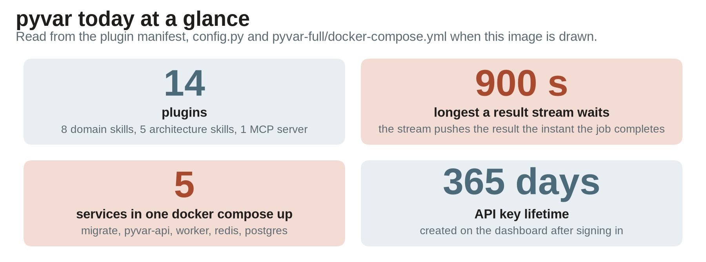

# pyvar Today: 14 Plugins, Real-Time Results, and a One-Command Deployment

*A follow-up to "14 Plugins, One API" — where the platform stands right now.*



*pyvar today at a glance, read from the manifest, the config and the compose file.*

> **Update (October 2026):** This article has been updated to reflect the latest changes in account sign-in and API keys (a returning user signs in with the same email form, and a signed-in session creates the key that plugins and scripts use), in how `pyvar-mcp` is installed, and in the Python packages. The plugin review statuses it listed are no longer stated, since they change.

---

pyvar.com is an open-source (Apache-2.0), Numba-accelerated risk computation platform covering VaR, credit risk, derivatives, liquidity, operational risk, portfolio analytics, ALM, and regulatory capital — 385 functions behind a single REST API. Here's what's available today.

## 14 plugins, three Python packages

```
/plugin marketplace add fibtecltd/pyvar
/plugin install pyvar-market-risk@pyvar-marketplace
```

8 domain skills (market risk, credit risk, liquidity risk, operational risk, portfolio analytics, regulatory, derivatives, ALM) and 5 architecture skills are plugins. `pyvar-mcp` — the MCP server that turns all 385 functions into Claude Code tools, generic (`list_pyvar_functions`, `call_pyvar_function`) and individually typed alike — is both a plugin and a package on PyPI: the plugin starts it with `uvx pyvar-mcp`. The Python client (`pip install pyvar-client`) and the notebook magics (`pip install pyvar-jupyter`) are on PyPI too.

The install command above is a direct GitHub-source marketplace add, live against this repository, independent of any directory review.

## Two ways to get a result

`POST /var/compute` submits a job the same way it always has. From there, you choose:

| | Poll | Stream |
|---|---|---|
| Endpoint | `GET /var/result/{task_id}` | `WS /api/v1/var/stream/{task_id}` |
| How you get the result | Ask until the status flips to `SUCCESS` | Held open, pushed the instant the job completes |
| What it costs | One request per check | One connection, no polling loop |

Both read from the same authoritative job state, so the stream endpoint never has to be trusted blindly: every wake-up — pushed or timed out — re-reads that state directly, bounded by `var_stream_max_wait_seconds` (900s). A result is never more than one poll interval (2s) stale on either path.

One difference: the poll path accepts an API key like every other endpoint, while the stream accepts a session token only, because a key in a query string would end up in access logs.

## One command, the full stack

`pyvar-full/` is a self-contained Docker distribution of the entire application — API, worker, Redis, Postgres — not just the compute engine:

```bash
cd pyvar-full/
docker compose up
```

That's the whole setup. No bind mounts, no external Docker network to create first, no separate migration step to remember — a one-shot `migrate` service runs automatically before the API comes up. `pyvar-local/` remains the narrower, engine-only package for people who just want the compute core.

## Two ways into an account

| | Email | Google |
|---|---|---|
| Steps | Enter your address → check inbox → click the link | Click the sign-in button |
| Result | A signed-in session, after the link is clicked | A signed-in session, immediately |
| Verification | Confirmed by the link click | Confirmed by Google's own `email_verified` claim |

`POST /auth/google` verifies the ID token Google Identity Services hands the frontend — signature, issuer, audience, expiry — and either creates a new verified account or signs into an existing one matched by email. Both paths end in the same place: a signed-in session on the dashboard, where you create the API key (`pyvar_...`, valid for a year, revocable) that plugins and scripts use. The same email form signs a returning user in.

## Try it

```
/plugin marketplace add fibtecltd/pyvar
/plugin install pyvar-market-risk@pyvar-marketplace   # any of the 13 skills
/plugin install pyvar-mcp@pyvar-marketplace            # the MCP server, started with uvx
```

```
pip install pyvar-client       # Python client; reads PYVAR_API_KEY
pip install pyvar-jupyter      # %pyvar and %%pyvar magics
```

The same call from each package: expected loss for a 1,000,000 exposure with a 2% probability of default and 45% loss given default. Each returns the same result: el 9,000 (0.9% of the exposure).

**pyvar-client** (`pip install pyvar-client`)

```python
from pyvar_client import Client

with Client() as client:  # reads PYVAR_API_KEY
    client.credit_risk.expected_loss_el_computation(pd=0.02, lgd=0.45, ead=1_000_000)
```

**pyvar-jupyter** (`pip install pyvar-jupyter`, then `%load_ext pyvar_jupyter`)

```
%pyvar credit_risk.expected_loss_el_computation pd=0.02 lgd=0.45 ead=1000000
```

**pyvar-mcp** (the `call_pyvar_function` tool, arguments shown as JSON)

```json
{"domain": "credit-risk", "function_name": "expected_loss_el_computation",
 "params": {"pd": 0.02, "lgd": 0.45, "ead": 1000000}}
```

`pyvar-full/` is a `docker compose up` away from a complete local instance, Google sign-in included once a Client ID is configured.

---

## Sources

- [`.claude-plugin/marketplace.json`](https://github.com/fibtecltd/pyvar/blob/master/.claude-plugin/marketplace.json) — 14-plugin manifest.
- [`api/routes/var.py`](https://github.com/fibtecltd/pyvar/blob/master/api/routes/var.py), [`tasks/var_task.py`](https://github.com/fibtecltd/pyvar/blob/master/tasks/var_task.py) — `WS /api/v1/var/stream/{task_id}`.
- [`config.py`](https://github.com/fibtecltd/pyvar/blob/master/config.py) — `var_stream_poll_interval_seconds`, `var_stream_max_wait_seconds`, `google_oauth_client_id`.
- [`pyvar-full/docker-compose.yml`](https://github.com/fibtecltd/pyvar/blob/master/pyvar-full/docker-compose.yml) — the one-command stack.
- [`api/routes/auth.py`](https://github.com/fibtecltd/pyvar/blob/master/api/routes/auth.py), [`api/routes/public_data.py`](https://github.com/fibtecltd/pyvar/blob/master/api/routes/public_data.py) — `POST /auth/google`, `GET /public/config`.
- [`docs/publications/pyvar-plugins-medium-article.md`](https://github.com/fibtecltd/pyvar/blob/master/docs/publications/pyvar-plugins-medium-article.md) — the original 14-plugin piece this one follows up on.
- [`docs/plugin-examples.md`](https://github.com/fibtecltd/pyvar/blob/master/docs/plugin-examples.md) — the same call through every surface.
