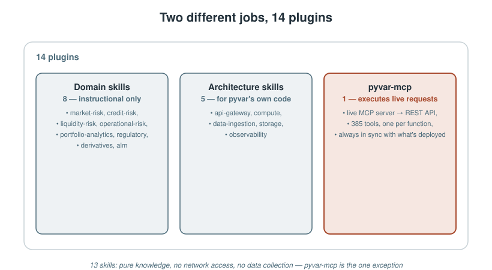
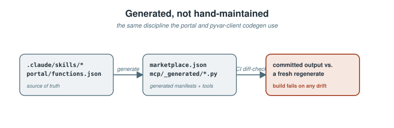

# 14 Plugins, One API: Putting 385 Regulatory Risk Functions Directly Into Claude Code

*How pyvar.com turned a REST API into a generated, self-verifying set of Claude Code skills and an MCP server — and what each one is actually for.*


*The plugins at a glance, read from the manifest and the code.*

> **Update (October 2026):** This article has been updated to reflect the latest changes in how the plugins are built, installed and authenticated. The eight domain skills are now generated with each function's real parameters and tested worked examples, the API uses durable API keys instead of one-hour tokens, and `pyvar-mcp` starts with `uvx` from PyPI. A real result for every plugin has been added, along with the same call through every surface.

> **Draft status:** not yet published. Every fact below is checked against
> this repository at drafting time (`.claude-plugin/marketplace.json`,
> `docs/proposals/marketplace-submission-content-per-plugin.md`,
> `plugins/mcp/README.md`, `portal/functions.json`) — see **Sources** at the
> end. Needs review before it goes anywhere.
> Diagrams are local SVGs (`./assets/diagrams/`) for repo/GitHub preview —
> re-upload them through Medium's own editor at publish time; relative
> paths don't carry over.

---

A REST API with 385 functions is only as useful as the thing calling it knowing which one to reach for. pyvar.com — an open-source (Apache-2.0), Numba-accelerated risk computation platform covering VaR, credit risk, derivatives, liquidity, operational risk, portfolio analytics, ALM, and regulatory capital — solved that by shipping straight into the tool its own build process already lived in: Claude Code.

Not as one plugin. As **14** — 8 domain skills, 5 architecture skills, and one MCP server — installable today from a single self-hosted marketplace:

```
/plugin marketplace add fibtecltd/pyvar
/plugin install pyvar-market-risk@pyvar-marketplace
```

This piece is about what those 14 actually are, why they're split the way they are, and — the part that took real discipline to get right — how they stay honest about what they can and can't do.

## Two different kinds of plugin, doing two different jobs

**8 domain skills** — one per risk domain (market risk, credit risk, liquidity risk, operational risk, portfolio analytics, regulatory, derivatives, ALM) — are instructional content, generated from the function catalogue. Each is a `SKILL.md` giving Claude every function's real route, parameters, types and defaults, the regulatory constants those functions enforce, a setup section (look for `PYVAR_API_KEY`, or walk the user through getting a key) and worked examples whose requests are run against the real application on every test run. No code execution, no network access, no data collection of any kind: Claude makes the calls, the skill only tells it how. Installing one doesn't grant Claude Code any new capability — it makes Claude noticeably better at knowing *when* to reach for `historical_simulation_var` versus `monte_carlo_expected_shortfall`, and what parameters each one actually expects.

**5 architecture skills** cover pyvar's own codebase instead of its risk-domain output — FastAPI route conventions, the Polars/PyArrow ingestion layer, the Numba/Celery compute layer, the Redis/PostgreSQL/S3 storage layer, and the Prometheus/Sentry/Bandit observability layer. These exist for people extending pyvar itself, not for people calling it — a genuinely different audience from the other 13.

**`pyvar-mcp`**, the 14th plugin, is the only one that actually talks to anything. It's an MCP server exposing all 385 functions as Claude Code tools — a thin wrapper over the live pyvar REST API, not a bundled copy of the compute engine, so results always match what's actually deployed at pyvar.com. It runs from PyPI: the plugin starts it with `uvx pyvar-mcp` and asks for your API key once, at install. Two generic tools cover most needs:

- `list_pyvar_functions(domain?)` — browse what's available, optionally filtered to one of the 8 domains.
- `call_pyvar_function(domain, function_name, params)` — call anything by name, with `params` validated against that function's own schema before the request goes out.

Plus all 385 functions individually, as precisely-typed named tools (`alm_stress_test`, `historical_simulation_var`, and so on) for when you already know exactly which one you want and don't need the generic dispatcher.



## Who each one is actually for

Domain skills and architecture skills answer genuinely different questions — "what would a risk team ask for" versus "what would an engineer touching this codebase need" — so their use cases don't overlap:

| Skill | Use case |
|---|---|
| `pyvar-market-risk` | A trading or market risk desk computing daily VaR/ES, running Basel traffic-light backtesting, or building FRTB SA/IMA capital numbers from inside a Claude Code session. |
| `pyvar-credit-risk` | A credit risk team computing IRB/SA regulatory capital, pricing XVA adjustments, provisioning IFRS 9 ECL, or scoring counterparty PDs for a credit committee memo. |
| `pyvar-liquidity-risk` | A treasury or liquidity risk team computing LCR/NSFR for a regulatory filing, building a cash-flow ladder, or running an internal ILAAP stress scenario. |
| `pyvar-operational-risk` | An op risk team running LDA/AMA/SMA capital models, scoring RCSA control effectiveness, or tracking KRI breaches ahead of a risk committee report. |
| `pyvar-portfolio-analytics` | A portfolio manager or quant running mean-variance/Black-Litterman/risk-parity optimisation, Brinson performance attribution, or ESG-integrated portfolio construction. |
| `pyvar-regulatory` | A regulatory reporting or compliance team computing Basel III/IV capital ratios, checking MiFID II/EMIR transaction-reporting scope, or running a Solvency II SCR calculation. |
| `pyvar-derivatives` | A derivatives desk pricing vanilla or exotic options (Black-Scholes through Heston/SABR/LSM), valuing bonds/IRS/CDS, or computing FX derivative sensitivities. |
| `pyvar-alm` | A treasury/ALM team computing duration gap, NII/EVE sensitivity under IRRBB's 6 standard shocks, or modelling non-maturity deposit behaviour. |
| `pyvar-arch-*` (5 skills) | An engineer extending pyvar's own FastAPI layer, ingestion pipeline, Numba/Celery compute workers, storage layer, or observability stack — not a risk-domain user at all. |
| `pyvar-mcp` | Anyone who wants to call any of the 385 functions directly from a Claude Code session or Claude.ai chat — pricing an option, computing a VaR, checking a capital ratio — without writing HTTP client code by hand. |

That table isn't hand-written marketing copy sitting off to the side of the actual product — it's the same "Use case" text now shipped on the live [plugins portal page](https://www.pyvar.com/plugins.html) and in the marketplace submission content, kept identical on purpose so nothing drifts between what's advertised and what's installed.

## Generated, not hand-maintained — the same discipline as the rest of the platform

Here's the part that matters more than the plugin count: none of these 14 manifests, none of the MCP server's 385 individually-typed tools, and none of the eight domain skills' function reference are written by hand. `pyvar-mcp`'s tool catalogue (`plugins/mcp/pyvar_mcp/_generated/functions.py`) and the plugin manifest (`.claude-plugin/marketplace.json`, `plugins/*`) are both generated directly from the repository's own source of truth — `.claude/skills/*` and `portal/functions.json` — and `scripts/sync_skills.py` renders each domain skill from that catalogue and the live OpenAPI schema. CI fails the build if committed output ever drifts from what regenerating actually produces, and a test posts every request in the skills' worked examples (28 requests in 16 examples) to the real application.

That's not a stylistic choice. It's the exact same "don't trust it, run it and check" discipline that caught a 79%-understated Solvency II capital formula before launch, applied to code generation instead of a regulatory formula: a docstring can go stale, a hand-maintained tool list can silently fall behind the API it's supposed to describe, but a generator that's re-run and diffed on every commit can't drift without CI noticing.



## One real result for every plugin

Each plugin has two worked examples in [`docs/plugin-examples.md`](https://github.com/fibtecltd/pyvar/blob/master/docs/plugin-examples.md) and in the [companion article](https://github.com/fibtecltd/pyvar/blob/master/docs/publications/pyvar-plugin-examples-medium-article.md), produced by running the real code on synthetic data. The first of each, in one line:

- **`pyvar-market-risk`** — the 99% VaR of a 10m portfolio is 238,046 (2.38%); the FRTB 97.5% Expected Shortfall is 245,467.
- **`pyvar-credit-risk`** — a 50m exposure at 2% PD and 45% LGD has an expected loss of 450,000 and a Vasicek 99.9% credit VaR of 3,967,401.
- **`pyvar-liquidity-risk`** — 120m of HQLA against 110m of net outflows is an LCR of 109.1%; the NSFR is 106.5%.
- **`pyvar-operational-risk`** — a 3bn Business Indicator with no loss history gives SMA capital of 227,356,439.
- **`pyvar-portfolio-analytics`** — two years of returns give a Sharpe ratio of 0.69, a Sortino ratio of 0.99 and a 29.6% maximum drawdown.
- **`pyvar-regulatory`** — 5.2bn of CET1 on 41bn of RWA is a 12.68% ratio, 8.18 points above the 4.5% minimum.
- **`pyvar-derivatives`** — a six-month 105-strike call on a 100 underlying is worth 4.9371 under Black-Scholes; the put is 7.8580.
- **`pyvar-alm`** — the worst of the six IRRBB shocks is parallel up, at -81,925,909: 9.1% of Tier 1, inside the 15% outlier test.
- **`pyvar-arch-api-gateway`** — a free-tier token is refused with a 403 above 10,000 simulations; the same body from a pro token is accepted with a 202.
- **`pyvar-arch-compute`** — two runs with seed 42 are bit-identical, and the 99% VaR (2.794%) sits above the 95% VaR (1.936%).
- **`pyvar-arch-data-ingestion`** — a date-windowed Parquet scan returns 353 of 504 observations, filtering while it reads.
- **`pyvar-arch-storage`** — a 200,000-path result is stored in S3 as Parquet and served through a presigned URL.
- **`pyvar-arch-observability`** — a confidence level of 0.5 is rejected with a 422 that lists the allowed range, 0.90 to 0.9999.
- **`pyvar-mcp`** — the server advertises 387 tools, and `call_pyvar_function` returns an expected loss of 9,000 for a 1,000,000 exposure.

The two Python packages have examples too: `pyvar-client` returns the same 238,046 VaR from Python, and `pyvar-jupyter`'s `%%pyvar` cell magic returns an expected loss of 40,000.

## Try it

```
/plugin marketplace add fibtecltd/pyvar
/plugin install pyvar-market-risk@pyvar-marketplace   # any of the 13 skills
/plugin install pyvar-mcp@pyvar-marketplace            # the MCP server
```

Sign in at https://www.pyvar.com#get-api-key (Google, or an emailed link), create an API key on the dashboard, and set `PYVAR_API_KEY`. The `pyvar-mcp` plugin asks for the key once at install and starts the server with `uvx pyvar-mcp` (`uvx` ships with `uv`). The free tier is 10 calls a day.

### The same call, through each surface

Expected loss for a 1,000,000 exposure with a 2% probability of default and 45% loss given default. [`docs/plugin-examples.md`](https://github.com/fibtecltd/pyvar/blob/master/docs/plugin-examples.md) runs this one call through every surface against a real local API and fails if the results ever differ.

**REST**

```bash
curl -X POST https://www.pyvar.com/api/v1/credit-risk/expected_loss_el_computation \
  -H "Authorization: Bearer $PYVAR_API_KEY" -H "Content-Type: application/json" \
  -d '{"pd": 0.02, "lgd": 0.45, "ead": 1000000}'
```

**pyvar-client** (`pip install pyvar-client`)

```python
from pyvar_client import Client

with Client() as client:  # reads PYVAR_API_KEY
    client.credit_risk.expected_loss_el_computation(pd=0.02, lgd=0.45, ead=1_000_000)
```

**pyvar-jupyter** (`pip install pyvar-jupyter`, then `%load_ext pyvar_jupyter`)

```
%pyvar credit_risk.expected_loss_el_computation pd=0.02 lgd=0.45 ead=1000000
```

**pyvar-mcp** (the `call_pyvar_function` tool, arguments shown as JSON)

```json
{"domain": "credit-risk", "function_name": "expected_loss_el_computation",
 "params": {"pd": 0.02, "lgd": 0.45, "ead": 1000000}}
```

Every surface returns the same result:

```json
{"el": 9000.0, "el_rate": 0.009, "pd": 0.02, "lgd": 0.45, "ead": 1000000.0}
```

---

## Sources

- [`.claude-plugin/marketplace.json`](https://github.com/fibtecltd/pyvar/blob/master/.claude-plugin/marketplace.json) — the 14-plugin manifest, names, descriptions.
- [`docs/proposals/marketplace-submission-content-per-plugin.md`](https://github.com/fibtecltd/pyvar/blob/master/docs/proposals/marketplace-submission-content-per-plugin.md) — per-plugin pitch, tags, and use-case text, verbatim source for the table above.
- [`portal/plugins.html`](https://github.com/fibtecltd/pyvar/blob/master/portal/plugins.html), live at [pyvar.com/plugins.html](https://www.pyvar.com/plugins.html) — the public-facing version of the same content.
- [`plugins/mcp/README.md`](https://github.com/fibtecltd/pyvar/blob/master/plugins/mcp/README.md) — install steps, tool descriptions, how the server is launched.
- [`portal/functions.json`](https://github.com/fibtecltd/pyvar/blob/master/portal/functions.json) — 385-function total, domain breakdown.
- [`docs/publications/pyvar-buildstory-medium-article.md`](https://github.com/fibtecltd/pyvar/blob/master/docs/publications/pyvar-buildstory-medium-article.md) — the generated-catalogue discipline and the Solvency II calibration this piece draws the parallel to.
- [`docs/plugin-examples.md`](https://github.com/fibtecltd/pyvar/blob/master/docs/plugin-examples.md) — the worked examples for every plugin and package, and the same call through every surface.
- [`scripts/sync_skills.py`](https://github.com/fibtecltd/pyvar/blob/master/scripts/sync_skills.py) — renders the domain skills from the catalogue and the OpenAPI schema.
- [`scripts/generate_article_headers.py`](https://github.com/fibtecltd/pyvar/blob/master/scripts/generate_article_headers.py) — draws this article's header image; every number in it is read from the code.
