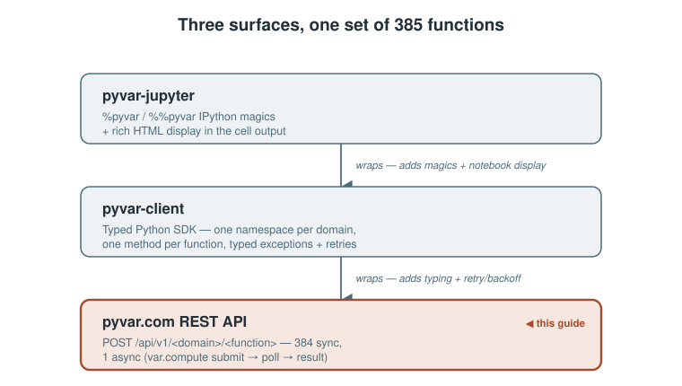

# Using pyvar.com's REST API Directly: Auth, Endpoints, Tiers, and Limits

*A practical guide to the raw REST API underneath `pyvar-client` and `pyvar-jupyter` — for anyone calling it with `curl`, from a language other than Python, or who just wants to know exactly what's happening under the SDK.*


*The REST API at a glance, read from the code.*

> **Update (October 2026):** This article has been updated to reflect the latest changes in authentication: a signed-in session manages durable API keys, which are what calls carry; a key's tier is read from the database; and the same call is shown through the Python client, notebooks and MCP.

> **Draft status:** not yet published. Every endpoint, status code, and
> limit below is taken directly from this repository's own route handlers,
> middleware, and `config.py` — see **Sources** at the end. Needs review
> before it goes anywhere. Diagrams are local SVGs (`./assets/diagrams/`)
> for repo/GitHub preview — re-upload them through Medium's own editor at
> publish time; relative paths don't carry over.

---

`pyvar-client` and `pyvar-jupyter` (covered in their own companion guides) are the recommended way to use pyvar.com from Python. This piece is for everything else: calling the REST API directly with `curl`, from another language, or just understanding exactly what the SDK is doing on your behalf.



## Get an account: register, sign in, create an API key

There's no password and no credit card for the free tier — just an email. The same call both registers a new address and signs a returning one in:

```bash
curl -X POST https://www.pyvar.com/api/v1/auth/register \
  -H "Content-Type: application/json" \
  -d '{"email": "you@example.com"}'
```

Returns `202 Accepted` immediately (whether or not the email exists yet, or is disposable/suppressed — the response shape never reveals which, so the registration flow can't be used to probe email validity). A link arrives by email (single-use; a sign-in link for an existing account is valid for 30 minutes, at most one is sent every 5 minutes per address). Clicking it hits:

```bash
curl "https://www.pyvar.com/api/v1/auth/verify?token=..."
```

which returns a 60-minute session token. ("Sign in with Google" on the homepage returns the same thing.) The session is only for managing keys:

```json
{"access_token": "eyJ...", "tier": "free"}
```

Use it to create an API key — the credential you actually keep:

```bash
curl -X POST https://www.pyvar.com/api/v1/auth/api-keys \
  -H "Authorization: Bearer eyJ..." -H "Content-Type: application/json" \
  -d '{"name": "laptop"}'
# {"key": "pyvar_...", "prefix": "pyvar_AbCd1234", "expires_at": "...", ...}
```

The key is shown once; pyvar stores only its hash. Every call then sends `Authorization: Bearer pyvar_...` (the Python client and the MCP server read it from `PYVAR_API_KEY`). A key lasts a year, you can hold up to five at a time, and `DELETE /auth/api-keys/{id}` (or the dashboard) revokes one immediately. A key cannot create or revoke keys; only a signed-in session can. The dashboard does all of this without `curl`: it creates your first key on first sign-in and lists, creates and revokes keys after that. Lost a key? Sign in again and create a new one. (A session token and a key both work as a bearer credential on every endpoint.)


## Your first computation

Every one of pyvar's 385 functions is a `POST` under `/api/v1/<domain>/<function_name>`, taking a JSON body matching that function's Pydantic schema and returning a JSON result:

```bash
curl -X POST https://www.pyvar.com/api/v1/market-risk/historical_simulation_var \
  -H "Authorization: Bearer pyvar_..." \
  -H "Content-Type: application/json" \
  -d '{
    "returns": [0.01, -0.02, 0.015, 0.008, -0.011],
    "portfolio_value": 1000000,
    "confidence_level": 0.99
  }'
```

The 8 domain prefixes: `/market-risk`, `/credit-risk`, `/derivatives`, `/liquidity`, `/operational`, `/portfolio`, `/regulatory`, `/alm`. The full, live list of all 385 functions and their exact request/response schemas is browsable at [`/docs`](https://www.pyvar.com/docs) — FastAPI's auto-generated OpenAPI UI, always in sync with what's actually deployed since it's generated from the same route definitions this article describes.

## The same call from the other surfaces

The REST call above is what every other surface sends for you. Expected loss for a 1,000,000 exposure, asked through each package. [`docs/plugin-examples.md`](https://github.com/fibtecltd/pyvar/blob/master/docs/plugin-examples.md) runs all four surfaces against a real local API and fails if the results ever differ.

**pyvar-client** (`pip install pyvar-client`)

```python
from pyvar_client import Client

with Client() as client:  # reads PYVAR_API_KEY
    client.credit_risk.expected_loss_el_computation(pd=0.02, lgd=0.45, ead=1_000_000)
```

**pyvar-jupyter** (`pip install pyvar-jupyter`, then `%load_ext pyvar_jupyter`)

```
%pyvar credit_risk.expected_loss_el_computation pd=0.02 lgd=0.45 ead=1000000
```

**pyvar-mcp** (the `call_pyvar_function` tool, arguments shown as JSON)

```json
{"domain": "credit-risk", "function_name": "expected_loss_el_computation",
 "params": {"pd": 0.02, "lgd": 0.45, "ead": 1000000}}
```

Every surface returns the same result:

```json
{"el": 9000.0, "el_rate": 0.009, "pd": 0.02, "lgd": 0.45, "ead": 1000000.0}
```

## The one async endpoint

`POST /api/v1/var/compute` is the exception: a real Monte Carlo job dispatched to pyvar's Celery/SQS worker fleet. It returns a `task_id` immediately, not a result:

```bash
curl -X POST https://www.pyvar.com/api/v1/var/compute \
  -H "Authorization: Bearer pyvar_..." -H "Content-Type: application/json" \
  -d '{"portfolio_value": 1000000, "returns": [...], "n_simulations": 100000}'
# {"task_id": "..."}

curl "https://www.pyvar.com/api/v1/var/result/<task_id>" \
  -H "Authorization: Bearer pyvar_..."
# {"status": "success", "result": {...}}   (or "pending" / "failure")
```

`pyvar-client`'s `client.var.compute()` and `pyvar-jupyter`'s `%pyvar var.compute` both just automate this submit-then-poll loop — nothing happens here that isn't visible in a plain `curl` exchange.

## Tiers and what they actually control

A session token carries your tier as a claim, decoded once per request with no database lookup. An API key looks your tier up (cached for up to 60 seconds), so an upgrade applies to a key almost immediately:

| Tier | Max simulations per `var.compute` call | Daily request cap (all endpoints combined) |
|---|---|---|
| Free | 10,000 | 10/day |
| Pro | 100,000 | 500/day |
| Enterprise | 500,000 | unlimited |

The daily cap is a single account-wide bucket shared across all 385 endpoints — not 385 separate quotas. Exceeding it returns `429 Too Many Requests` with a `Retry-After` header telling you exactly how many seconds until the window resets:

```bash
curl -i ... 
HTTP/1.1 429 Too Many Requests
Retry-After: 43201
{"detail": "Rate limit exceeded. Please retry later."}
```

Requesting more simulations than your tier allows on `var.compute` fails fast, before anything is queued:

```json
{"detail": "Your 'free' tier allows a maximum of 10,000 simulations. Requested: 50,000."}
```
— a `403 Forbidden`, not a `422`, since the request is well-formed; it's just not something this account is entitled to.

## Pro's monthly caps, and what happens if you hit one

Beyond the daily request cap, Pro accounts carry two **monthly** caps that don't just throttle — breaching either one hard-downgrades the account to Free for the rest of the billing period:

- **5,000 requests/month**, checked generically across every endpoint.
- **2,000,000 simulations/month**, checked only against `var.compute` (the one endpoint that tracks simulation counts at all).

Hit either one, and the response is a `403` explaining exactly what happened and when it resolves:

```json
{"detail": "Your Pro plan's monthly request limit has been reached. Your account has moved to the Free plan for the rest of this billing period; full Pro limits resume automatically at your next billing date."}
```

This isn't a silent downgrade — it writes an audit record and sends a notification email — and it isn't permanent: the account is automatically restored to Pro the next time a subscription invoice is paid successfully, with no action needed from the user.


## Upgrading to Pro

```bash
curl -X POST https://www.pyvar.com/api/v1/billing/checkout \
  -H "Authorization: Bearer pyvar_..."
# {"checkout_url": "https://checkout.stripe.com/..."}
```

Redirect to that URL — it's Stripe's own hosted Checkout page, so pyvar's infrastructure never touches card details directly. After payment, Stripe redirects back to pyvar's dashboard with a `?checkout_session_id=...` query parameter, which the frontend exchanges for a fresh session token:

```bash
curl "https://www.pyvar.com/api/v1/billing/checkout/complete?session_id=cs_..."
# {"access_token": "eyJ...", "tier": "pro"}
```

If you use a session token, that exchange step matters: your existing JWT's `tier` claim doesn't update itself just because Stripe processed a payment — the database changes immediately (via a webhook Stripe calls server-to-server), but an *already-issued* token keeps whatever tier it was minted with until you fetch a new one. `GET /billing/checkout/complete` is that one bridge — without it, a successful subscription would be real in the database but invisible to a session token until it was replaced. API keys do not need this step: they read the tier from the database, so a key created before the upgrade is Pro as soon as its short cache entry lapses.

## What's deliberately out of scope today

Enterprise tier is a manual, sales-assisted process — there's no self-service checkout for it, by design. And Pro's entire value proposition today is the higher daily/monthly caps above; no priority queue, no extended result retention yet — both explicitly deferred to a later phase, not silently missing.

## Try it

```bash
# 1. Register or sign in (check your email for the link)
curl -X POST https://www.pyvar.com/api/v1/auth/register \
  -H "Content-Type: application/json" -d '{"email": "you@example.com"}'

# 2. Verify (from the emailed link) -- copy the access_token (a 60-minute session)
curl "https://www.pyvar.com/api/v1/auth/verify?token=..."

# 3. Create an API key with that session -- copy the key, it is shown once
curl -X POST https://www.pyvar.com/api/v1/auth/api-keys \
  -H "Authorization: Bearer eyJ..." -H "Content-Type: application/json" -d '{}'

# 4. Compute something
curl -X POST https://www.pyvar.com/api/v1/market-risk/historical_simulation_var \
  -H "Authorization: Bearer pyvar_..." -H "Content-Type: application/json" \
  -d '{"returns": [0.01,-0.02,0.015,0.008,-0.011], "portfolio_value": 1000000}'
```

---

## Sources

- [`api/routes/auth.py`](https://github.com/fibtecltd/pyvar/blob/master/api/routes/auth.py) — registration and sign-in, the session token, API key management.
- [`api/middleware/auth.py`](https://github.com/fibtecltd/pyvar/blob/master/api/middleware/auth.py) — session-token and API-key authentication, `TokenPayload`, per-tier `max_simulations`.
- [`api/middleware/api_keys.py`](https://github.com/fibtecltd/pyvar/blob/master/api/middleware/api_keys.py) — key generation, hashing, the cache and the failure modes.
- [`api/middleware/rate_limit.py`](https://github.com/fibtecltd/pyvar/blob/master/api/middleware/rate_limit.py) — daily and monthly request-count caps, the shared-scope design, downgrade trigger.
- [`api/routes/var.py`](https://github.com/fibtecltd/pyvar/blob/master/api/routes/var.py) — the async `var.compute`/`var.result` endpoints, the monthly simulation-count cap.
- [`api/routes/billing.py`](https://github.com/fibtecltd/pyvar/blob/master/api/routes/billing.py) — Stripe Checkout flow, the session-token refresh bridge, webhook-driven tier changes.
- [`config.py`](https://github.com/fibtecltd/pyvar/blob/master/config.py) — the actual numeric limits (`rate_limit_free_daily`, `rate_limit_pro_daily`, `rate_limit_pro_monthly_requests`, `rate_limit_pro_monthly_simulations`) quoted directly.
- [`main.py`](https://github.com/fibtecltd/pyvar/blob/master/main.py) — router registration, the 8 domain prefixes, `/docs` OpenAPI UI.
- [`docs/publications/pyvar-client-guide-medium-article.md`](https://github.com/fibtecltd/pyvar/blob/master/docs/publications/pyvar-client-guide-medium-article.md), [`pyvar-jupyter-guide-medium-article.md`](https://github.com/fibtecltd/pyvar/blob/master/docs/publications/pyvar-jupyter-guide-medium-article.md) — the companion SDK/notebook guides this piece complements without repeating.
