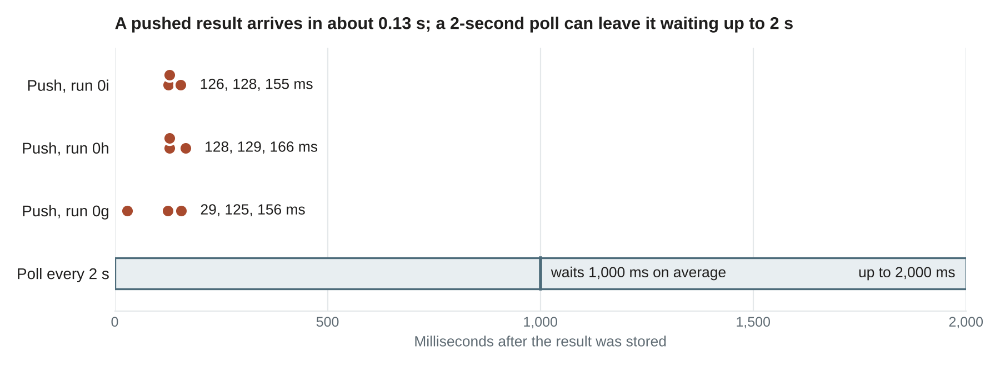
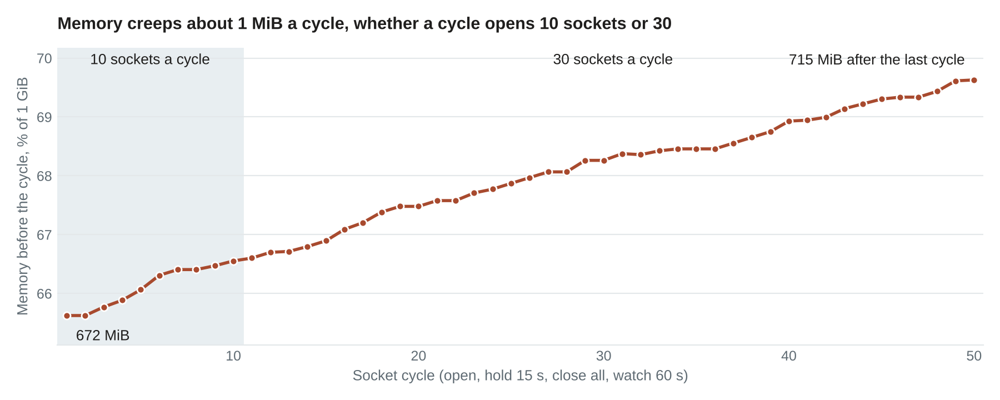

# pyvar Now Streams Job Results: One WebSocket Instead of a Polling Loop

*Submit a Monte Carlo VaR job, open a socket on its task id, and the result is pushed to you about a tenth of a second after the worker stores it. How to use it, and how it performed when we measured it.*


*The result stream at a glance, read from the code.*

---

The pyvar streaming service is now available on the dev endpoint, `https://dev.pyvar.com`. Every example below uses it, and every number was measured against it. This piece is the practical version: what it is, the four steps to use it, and how it performed.

**Scope, so nobody is surprised.** What is available is *result streaming* for the asynchronous Monte Carlo VaR job: you submit a job, and the answer is pushed to you when it is done instead of being fetched in a loop. It is not a market-data feed. You cannot push quotes in, and the other 385 functions are unchanged: they return their result in the POST response.

## What changes for a client

Until now an asynchronous VaR job had one way out:

```
POST /api/v1/var/compute            ->  202 {"task_id": "..."}
GET  /api/v1/var/result/{task_id}   ->  pending ... pending ... success    (every N seconds)
```

Now there is a second way:

```
POST /api/v1/var/compute                ->  202 {"task_id": "..."}
WS   /api/v1/var/stream/{task_id}       ->  one text frame, then the server closes
```

The frame is the same JSON the poll endpoint returns, so code that already handles the poll response handles the frame without changes. The poll endpoint is still there, and it is the fallback for everything below.

## Use it in four steps

**1. Have a credential.** An API key (`pyvar_...`, created after you sign in; the [REST API guide](https://github.com/fibtecltd/pyvar/blob/master/docs/publications/pyvar-rest-api-guide-medium-article.md) walks through it) or the 60-minute session token that signing in returns. Both work for the next two calls. Neither goes in the WebSocket URL; step 3 explains why.

**2. Submit the job.**

```bash
curl -X POST https://dev.pyvar.com/api/v1/var/compute \
  -H "Authorization: Bearer pyvar_..." -H "Content-Type: application/json" \
  -d '{"portfolio_value": 1000000, "returns": [...252 daily log-returns...],
       "confidence_level": 0.99, "horizon_days": 1, "n_simulations": 10000}'
```

A `202` carries the `task_id` to stream. A `200` means an identical request was answered from the cache: the result is already in the body (with `task_id` set to `"cached"`) and there is nothing to wait for. A `403` means `n_simulations` is above your tier's cap (10,000 on the free tier, 100,000 on Pro, 500,000 on Enterprise).

**3. Get a stream token.** A browser cannot set an `Authorization` header on a WebSocket handshake, so a credential would have to travel in the URL, and URLs get logged. Exchange yours for a token that is safe to put there:

```bash
curl -X POST https://dev.pyvar.com/api/v1/var/stream-token/$TASK_ID \
  -H "Authorization: Bearer pyvar_..."
# {"task_id": "...", "token": "eyJ...", "expires_in": 60}
```

The token lasts 60 seconds, opens the stream of that one task, and is refused by every other endpoint, so a URL that ends up in a log is worth nothing a minute later. Connect right after you get it.

**4. Open the socket and read the frame.** In Python, with `httpx` and `websockets`:

```python
import json

import httpx
import websockets

BASE = "https://dev.pyvar.com"


async def stream_result(task_id: str, api_key: str) -> dict:
    async with httpx.AsyncClient(base_url=BASE) as http:
        minted = await http.post(
            f"/api/v1/var/stream-token/{task_id}",
            headers={"Authorization": f"Bearer {api_key}"},
        )
        minted.raise_for_status()
    url = f"wss://dev.pyvar.com/api/v1/var/stream/{task_id}?token={minted.json()['token']}"
    async with websockets.connect(url) as ws:
        return json.loads(await ws.recv())  # one frame; the server closes after it
```

In a browser, the standard API does the same. Mint the token on your own server if you hold an API key (a key should not sit in page JavaScript), or with the signed-in session token if the page has one:

```javascript
const ws = new WebSocket(`wss://dev.pyvar.com/api/v1/var/stream/${taskId}?token=${streamToken}`);
ws.onmessage = (event) => render(JSON.parse(event.data));
ws.onclose = (event) => { if (event.code === 1013) pollInstead(taskId); };
```

For a 10,000-path job on a year of synthetic daily returns, a local run of this code produced the following frame (`loss_dist` shortened here to its first and last values; it holds all 10,000 sorted losses):

```json
{"task_id": "3f2b...", "status": "success", "error": null,
 "result": {"var_pct": 0.026391, "var_abs": 26390.78,
            "cvar_pct": 0.030364, "cvar_abs": 30363.66,
            "loss_dist": [-0.0440, -0.0432, "...", 0.0441],
            "mu": -0.0000804, "sigma": 0.0112292,
            "n_simulations": 10000, "confidence_level": 0.99, "horizon_days": 1,
            "s3_key": null, "presigned_url": null, "duration_ms": 2}}
```

`status` is `success` or `failure`; on `failure`, `result` is `null` and `error` says why. Above 10,000 simulations the distribution is not inlined: `loss_dist` is an empty list and `presigned_url` points to the full result as a Parquet file, so the frame stays small however big the job.

## What the server does with your socket

| Situation | What you get |
|---|---|
| The job finishes | One frame, `success` or `failure`, then close code 1000 |
| The job had finished before you connected | The same frame at once, then close 1000 |
| No token; an invalid, expired or wrong-task token; or an API key | The handshake completes, then close 1008 ("Missing token" or "Invalid or expired token") |
| Too many open streams | Close 1013 ("Too many open streams on this server" or "...for this account"): poll instead, or retry later |
| Nothing after 900 seconds | A frame with status `pending` and the text "Timed out waiting for job completion - the job may still be running; poll GET /var/result/{task_id} to check.", then close 1000 |

All of these were exercised on dev. A stream token minted for one task and used on another closes 1008, and so does one used after 65 seconds. A stream token sent as a bearer token to `GET /var/result/{id}`, to `POST /auth/api-keys` or to `POST /var/stream-token/{id}` is refused with 401 ("Invalid audience"). Minting without a credential gives 401, and a malformed task id gives 422. A session token as `?token=` on a finished job still returns the frame.

Four practical notes:

- **One socket per job.** Open it after the `202`. A job that is already done is answered before the stream limits apply.
- **Limits.** Waiting streams are capped per server process: 25 in all and 5 per account, with two processes in each API container. At the cap you get 1013, and the poll endpoint still works.
- **HTTP/1.1 only.** A WebSocket cannot upgrade over HTTP/2. Browsers and the common libraries handle this; if you build your own TLS context, offer `http/1.1` and not `h2`. The server pings every 20 seconds, and standard clients answer on their own.
- **Keep the key out of the URL.** The stream takes a stream token, or a session token, and never an API key: URLs are logged by the API and by the CDN in front of it. The API's access log does record the full URL, token included, so what matters is that a stream token is worth nothing a minute later: a logged URL is harmless; a session token lasts an hour, so prefer the stream token. Like the poll endpoint, the stream answers any signed-in caller who holds the task id, and task ids are random UUIDs, so treat one like a secret in shared logs.

## How it performs

All measurements are from `dev.pyvar.com`: 0.5 vCPU and 1 GiB per API container, two server processes, driven by a scripted client in AWS through CloudFront, the WAF and the load balancer. Push lag is read against the worker's own "succeeded in" log time (about 10 ms of error), and each run used three jobs, so read the figures as an order of magnitude, not a distribution.

| Measure | Result |
|---|---|
| Minting a stream token | 76, 81 and 101 ms |
| Frame after the worker stored the result | 126, 128 and 155 ms in the latest run, opened with a stream token; 128, 129 and 166 ms and 29, 125 and 156 ms in the two before |
| Socket opened on a job that had already finished | 21 ms (one measurement, a 22 kB frame) |
| WebSocket handshake through the edge | 1,300 of 1,300 returned 101; median 80 ms, worst 638 ms |
| Server frees a closed client's slot | within 0.65 s, for 1,300 of 1,300 sockets |
| Errors and failure log lines over the 2 h 22 min the task ran, including six 30-socket cycles | 0 |
| API container, idle | 61.8% of 1 GiB memory, 1.1% CPU, 5 cache connections |
| API container with 30 sockets held | 1.7 to 3.2% CPU; 9 to 13 cache connections in every cycle |
| API container after 50 socket cycles (1,300 sockets), then 10 idle minutes | 672 to 715 MiB of 1 GiB, flat while idle; 11 to 18 cache connections, not stepping |

Against polling every 2 seconds, the arithmetic is simple: a result stored at a random moment waits between 0 and 2 seconds for the next poll, 1 second on average, while the push takes around 0.13 s. The saving is largest for short jobs and for interfaces where a person is watching a spinner. For a long batch, polling every few seconds costs nothing noticeable.



*Frame arrival after the result was stored: nine measured jobs against the band a 2-second poll covers.*

What streaming does not change is everything before the result is stored. On dev, with the worker pool at zero (it scales to zero about four minutes after the last job), one job took 162 seconds from POST to success, 6.2 s of it on the cold worker. And the compute itself is whatever the job needs: the other 385 functions are ordinary synchronous calls, and measured in-process on the same container size 371 of their 386 example requests had a median under 50 ms (overall median 5.9 ms), the slowest being the rough-volatility pricer at about 4 seconds.

**Holding sockets open.** The per-process limits (25 and 5) are configuration, not a measured maximum: the longest dev run held 30 sockets at a time across the container, 40 times, and no socket was ever refused. Memory under churn is the figure to watch. Over 50 cycles and 1,300 sockets (10 cycles of 10 sockets, then 40 of 30) the container's memory grew from 672 MiB to 715 MiB: about 1 MiB a cycle at first, easing to 0.77 MiB a cycle over the last ten. The step followed the number of cycles, not the number of sockets: about 1 MiB a cycle for 10-socket cycles and for 30-socket ones alike (the metric resolves 1 MiB, so that comparison is at its limit). It did not drift while the container then sat idle for ten minutes, and the cache connections wandered between 11 and 18 without stepping. The curve is slowing but has not levelled off; on a straight line from the last ten cycles, the 85% mark (870 MiB) is about 200 cycles away.



*Memory before each socket cycle, 50 cycles on dev.*

## Sources

- [`api/routes/var.py`](https://github.com/fibtecltd/pyvar/blob/master/api/routes/var.py): the `WS /var/stream/{task_id}` route, its limits and close codes.
- [`schemas/var.py`](https://github.com/fibtecltd/pyvar/blob/master/schemas/var.py): the frame (`JobResultResponse`, `VaRResult`).
- [`tasks/var_task.py`](https://github.com/fibtecltd/pyvar/blob/master/tasks/var_task.py): the worker's completion signal.
- [`config.py`](https://github.com/fibtecltd/pyvar/blob/master/config.py): the 900 s wait, the stream limits, the 10 s safety re-read.
- [`docs/plan-streaming-quotes-in-results-out.md`](https://github.com/fibtecltd/pyvar/blob/master/docs/plan-streaming-quotes-in-results-out.md), section 9: the measurement runs behind the table above. [`docs/data/streaming-phase0d-latency.csv`](https://github.com/fibtecltd/pyvar/blob/master/docs/data/streaming-phase0d-latency.csv): the per-function latencies.
- [`docs/data/streaming-push-lag-dev.csv`](https://github.com/fibtecltd/pyvar/blob/master/docs/data/streaming-push-lag-dev.csv): the nine push delays in the first chart. [`docs/data/streaming-memory-cycles-dev.csv`](https://github.com/fibtecltd/pyvar/blob/master/docs/data/streaming-memory-cycles-dev.csv): the 50 cycles of the memory chart.

*How this was made: written with Claude Code. The AWS measurements were taken by a scripted agent on the dev stack and are quoted from its reports; the example frame was produced locally on the code in this repository. Minting with a real API key is covered by the test suite but was not run on dev, where the agent minted with a service session token.*
