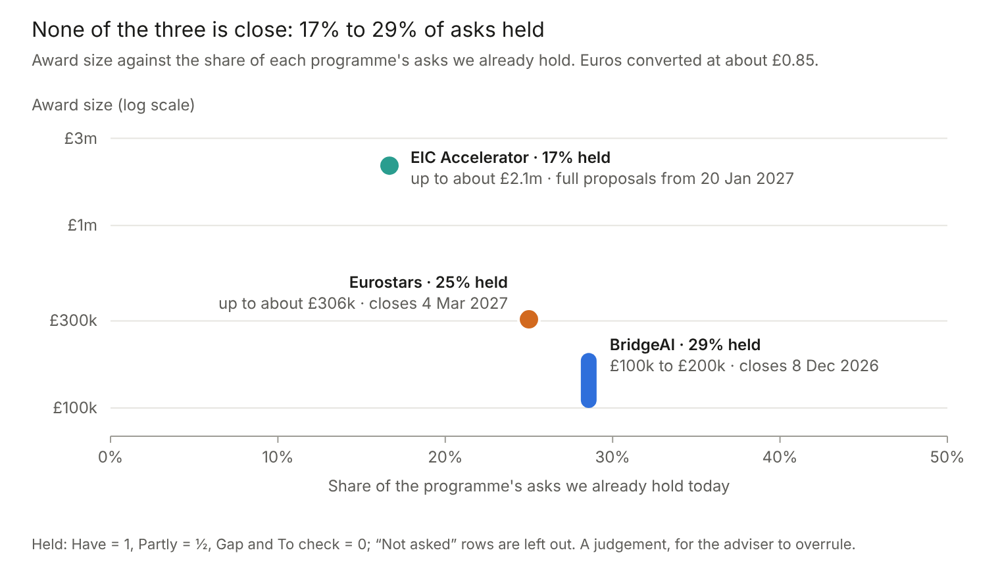
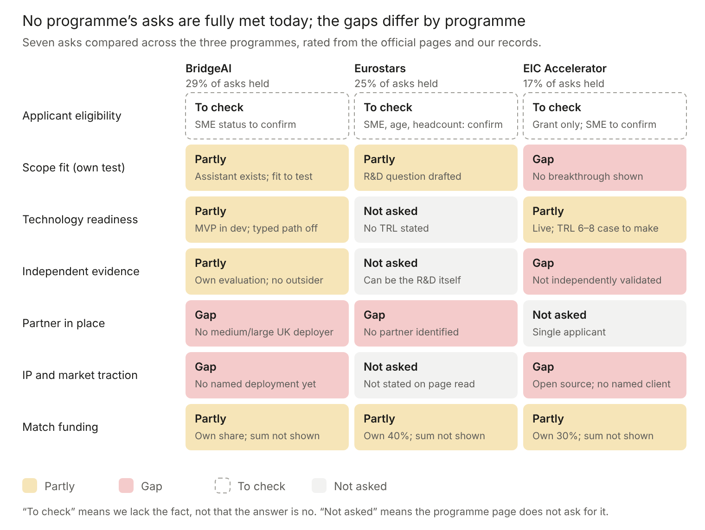
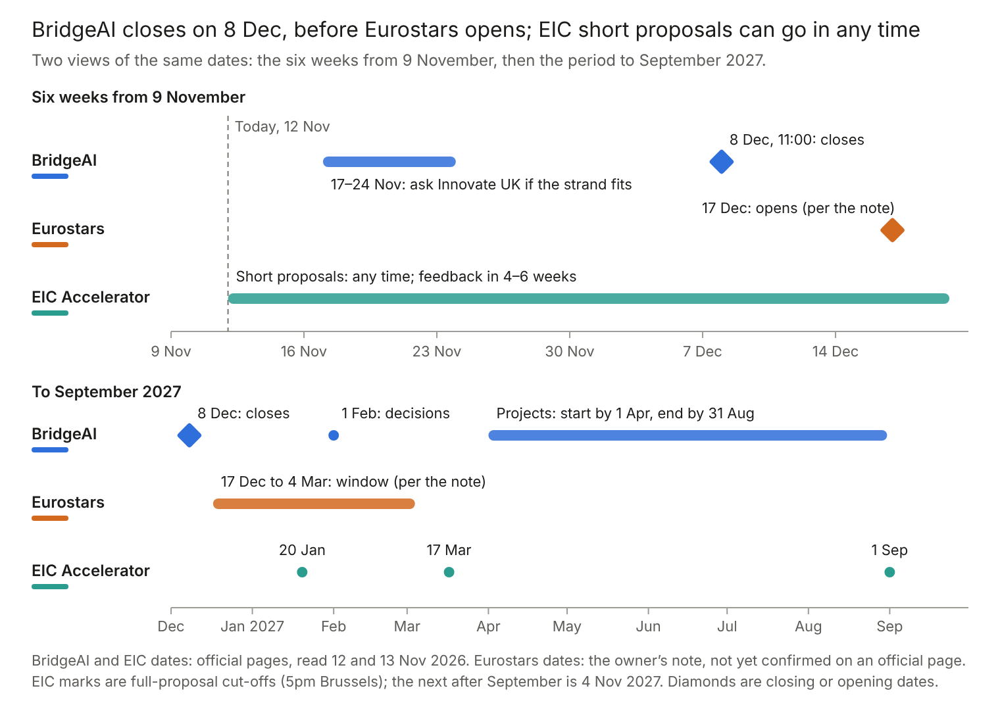

# pyvar: funding fit SWOT

**Version 1, 12 November 2026 (revised 13 November 2026 after review).** How pyvar fits the three funding programmes in the adviser's short note: Eurostars, BridgeAI Deployment Catalyst (AI for Decision Critical Systems) and the EIC Accelerator Open. Programme facts were checked on 12 November against the programmes' official pages (listed under Sources); where a fact could not be confirmed, the text says so. pyvar's facts come from this repository. **This repository is public, so facts about Fibtec Limited itself (size, age, headcount, match funding) are deliberately not recorded here.** Where a programme's eligibility depends on them, the document rates the item "To check". The revision limits the privacy statement to the menu path, gives each count its method and commit, replaces relative dates with absolute ones, and records that the BridgeAI, Eurostars and EIC pages were read again on 13 November (see Sources).

## Summary

The same gap blocks all three programmes: pyvar has not been independently validated (the README says so itself) and has no named customer deployment. Beyond that, each programme asks for something different.

- **Eurostars** is the best-shaped route. The adviser's note describes it as further development of the risk-computation technology combined with independent validation and testing against financial-sector requirements, provided it is a genuine R&D partnership and not simply commissioning testing. It needs a partner in another participating country, and none is identified yet. The next call is expected to open 17 December 2026 and close 4 March 2027 (the adviser's note; no official page I could reach confirms those dates yet).
- **BridgeAI** is conditional, and the deployer is the blocker. It requires an AI or machine-learning solution at TRL 5 to 6 with AI central to it. pyvar's computation is numerical, but it now has a real AI component: the portal assistant, an answer bank written by Claude models and gated by programmatic graders and a second model, with an evaluation harness behind it. Whether a help assistant counts as "decision critical" and as more than routine integration of an existing AI service is a question for Innovate UK, due by 24 November. The programme also needs a UK medium or large deployer; financial services is a listed sector, but none is identified. The deadline is Tuesday 8 December 2026, 11:00 UK time.
- **The EIC Accelerator** is a 2027 route and not now: it asks for a deep-tech breakthrough, an IP strategy, validation and early investor traction, and pyvar is open source with none of those yet.

Any other funding application Fibtec makes competes with these for the same people and the same match funding, so the first decision is which product takes the funded slot. (NLnet is covered separately in `docs/plan-nlnet-submission.md`; its planned deadline was 3 November 2026.)

Suggested order: start independent validation now, because every route needs it; decide which Fibtec product takes the funded slot; check Fibtec's eligibility with Innovate UK; if Eurostars, define the research question and look for a partner; do not pursue BridgeAI unless Innovate UK confirms the strand fit and a committed deployer appears by 24 November; leave the EIC.

## Where pyvar stands

Readiness is the share of each programme's asks that pyvar already holds, taken from the seven asks in the matrix below. A rating of Have counts 1 and Partly counts a half; Gap and To check count 0, and asks a programme does not make are left out. It is a judgement made from the official pages and this repository, and the adviser should overrule any cell. Applicant eligibility is rated "To check" everywhere because it depends on company facts kept outside this repository; rating it Have would raise every programme by a similar amount.

None of the three is close. Read the percentages as counts (2 of 7, 1 of 4 and 1 of 6): the programmes make different numbers of asks, so one cell moves Eurostars by 25 points and the three cannot be compared one for one. Readiness is also not fit: Eurostars is called the best-shaped route because its asks match work that could be done (a research question with a checkable answer), not because pyvar already holds more of them. Where a programme asks for technology readiness, "Partly" means a working platform exists; no TRL is asserted (see the table below).

The BridgeAI deadline falls before Eurostars opens. Independent validation feeds all three.

## pyvar today: what a funder would check

| A funder asks | What we can show today | Where it is recorded |
| --- | --- | --- |
| What is it, and is it live? | An open-source (Apache-2.0) platform with 385 risk functions in 8 domains (market, credit, derivatives, liquidity, ALM, operational, portfolio analytics, regulatory), served as a REST API at pyvar.com with a free tier. Reached through Claude Code skills, an MCP server (`pyvar-mcp`), a Python client, a Jupyter extension and a local Docker image. Pro-tier billing is implemented. | `README.md`, `CHANGELOG.md` |
| What does the AI do? | Nothing in the computation core, which is NumPy, SciPy and Numba. AI appears in four places. (1) The **portal assistant**: 1,154 menu answers (explain, when to use, compare) for the 385 functions, written ahead of time by a Claude model, checked by programmatic graders (identifiers, numbers, advice, wording, length) and a second model acting as gate, rewritten once on a flag and otherwise replaced by static text built from the catalogue; a typed-question path with an agent loop and guardrails is built behind a feature flag that is off, with a watchdog that audits its live answers (also off). It is measured by an evaluation harness, and the menus are switched on in the dev environment only. (2) The access layer: an AI agent can call every function as a tool (MCP server and Claude skills). (3) Two small machine-learning-flavoured functions: a probability-of-default calibration helper and a two-state Gaussian regime detector. (4) The development process: substantial assistance from Claude Code, under human review (222 of 677 commits at the README's count carry the trailer). | `assistant/README.md`; `docs/plan-portal-ai-assistant.md`; `docs/assistant-phase0-results.md`; `docs/assistant-plan-implementation.md`; `README.md` ("Use of Generative AI"); `engine/credit_scoring.py`; `engine/portfolio_factor.py` |
| How good is the AI component? | Phase 0 (three paid runs, $4.30, reported 9 November) measured mechanical pass rates of 96% to 100% and judged-faithful rates of 91% to 99% on samples of 40 to 80 answers, with 95% intervals reaching down to 83% for one measure. That report put the assistant work on hold; later work added the answer bank with a second-model gate (`assistant/README.md`) and measured the typed-question path through the shipped pipeline (results 9.27 to 9.33: on 175 script-written in-scope questions, one draw, an Opus judge flagged 6 answers from Haiku 5.5, 3.4% with a 95% interval of 1.6% to 7.3%; the prompt now shipped was measured on a 77-case slice only). Whether a generated answer beats the static text built from the catalogue is not established, and nobody outside Fibtec has evaluated it. It is not live in production: the menus are on in the dev environment only, and the typed path and its watchdog are off everywhere (`docs/assistant-plan-implementation.md`). | `docs/assistant-phase0-results.md`; `assistant/README.md`; `CLAUDE.md` section 3.6 |
| What is built beyond calling a library? | Regulatory formulas with the Basel and FRTB thresholds fixed in code and tests; 58 Numba `@njit` kernels in `engine/`, 14 of them with `parallel=True` (a static count of decorator lines at commit `dfbf0cc`; the README's "84 of 389 JIT-compiled, 13 parallel" could not be reproduced by any static count and should be reconciled with this one); an asynchronous job pipeline (Celery and SQS) with an audit table; API keys, tiers and usage tracking; an Iron Triangle data contract (time, cost, accuracy), each axis labelled real, estimated or static. | `CLAUDE.md`; `docs/p8-iron-triangle-data.md` |
| Does it work in production? | Live on AWS. 2,124 test functions (a static count of `def test_` definitions, methods and async tests included, at commit `dfbf0cc`), 685 of them reference-validation tests across the eight domains in `tests/validation/`; soak and smoke tests recorded; a streaming quotes-in, results-out service explored, with Phase 0 latency measured for all 385 functions. | `tests/`; `docs/p9-soak-test-status.md`; `docs/plan-streaming-quotes-in-results-out.md` |
| Are the results correct? | **Checked by pyvar's own suite, not by anyone independent.** Each function is compared with an external reference computed inside the test (closed form, scipy, hard-coded regulatory thresholds or an independent hand calculation). Four regulatory bugs were found and corrected before launch. The suite lists its own limits: several FRTB aggregation formulas have no published numeric worked example to match. The README states that pyvar is not independently validated for regulatory use. | `tests/validation/`; `README.md` |
| What readiness level can we assert? | The platform is live. For a funder's TRL scale no level is asserted until independent validation exists. | This document |
| Customers, pilots, revenue? | No named enterprise deployment ("there aren't any yet"). Usage and revenue are not recorded in the repository. | `docs/medium-building-pyvar-with-claude-code.md` |
| Team and IP? | Built by Fibtec Limited. Copyright is Fibtec's, but the Apache-2.0 licence gives anyone broad rights to use, modify and redistribute the code. No registered IP is recorded. Team facts are kept outside this repository. | `LICENSE`; `README.md` |
| What does it depend on? | AWS (ECS Fargate, EC2 Spot workers, SQS, Aurora Serverless v2, CloudFront and others); Stripe for billing; Anthropic's Claude for development assistance. | `CLAUDE.md` |
| What is the regulatory posture? | pyvar computes; it does not advise. It makes no claim of regulatory approval and says it is not independently validated for regulatory use. Regulatory logic is marked `[REGULATORY]` in the code and changes go through a separate review branch. | `README.md`; `CLAUDE.md` |

## Eurostars: international collaborative R&D

**What it asks.** The Innovate UK page for the March 2026 call is the latest I could read; the next call's dates come from the adviser's note. A project must be led by an innovative SME from a Eurostars country. It needs at least two independent organisations from at least two Eurostars countries, one of them from the EU or a Horizon Europe associated country (the UK counts). SMEs must hold at least 50% of the budget, no single participant or country may hold more than 70%, the project runs at most 36 months, and the use must be civil. Innovate UK funds UK SMEs only: up to €360,000 per project (about £306,000), covering up to 60% of project costs. UK universities, research organisations and large companies receive no UK budget and join at their own cost. After ranking, UK funding also depends on Innovate UK having budget for the project. Pages for earlier calls also state that UK micro-entities need at least three full-time employees by the deadline, that the applicant must have been registered at Companies House for at least 12 months, and that a UK SME can hold only one live Eurostars project at a time; the page I read for the March 2026 call does not repeat them, so they need checking with Innovate UK.

**Dates.** The adviser's note gives the next call as opening 17 December 2026 and closing 4 March 2027 at 14:00 Brussels time, 16 weeks after 12 November. The Innovate UK page confirms the previous call (16 January to 19 March 2026). The Eureka site, which would confirm the next one, was not reachable from here.

**Strengths**

- A ready technical base for the development half: 385 functions, a reference-validation suite a partner can extend, and an open licence that lets a partner read, run and criticise the code without negotiating access.
- A real research question with a checkable answer: how to make regulatory risk computations reproducible and verifiable by an independent party (reference cases, tolerances, determinism of parallel simulation, tools to explain a discrepancy). A second thread exists in the streaming recalculation work, whose Phase 0 measurements are recorded.
- The structure fits: a UK company and a partner in another participating country meet the two-country rule, and the use is civil.
- The adviser's note already frames it this way.

**Weaknesses**

- No partner is identified. Independent validation on its own is the "commissioning testing" the programme excludes; the project needs shared research tasks and shared risk.
- Fibtec's eligibility for UK funding is not yet checked: SME status, registration age, the employee rule for micro-entities and the one-live-project rule. The facts are held outside this repository.
- Another Fibtec application would compete for the same people and match funding. At up to 60% funding, at least 40% of eligible costs must come from Fibtec and its partners.
- Development is substantially AI-assisted. A funder's AI-use policy may govern how funded work may be produced; the streaming plan already notes this. Neither Innovate UK's nor Eureka's policy was read.
- No customer deployment to anchor the market case.

**Opportunities**

- A university group in quantitative finance, financial mathematics or numerical analysis, a model-validation firm, or a bank's validation team in a participating country could be the independent partner; `docs/pyvar-validation-partners.md` lists where to look.
- A publishable outcome: an open set of reference cases and tolerances that others can reuse, which also builds the project's credibility.
- Banks and insurers have to evidence that the models they use are validated, so independent validation evidence has a buyer.

**Threats**

- The commissioning-testing trap: if the partner only checks pyvar's work, the application fails its key requirement.
- Open source cuts both ways: a partner needs little from Fibtec to use the code, which weakens the case for a joint project. Ownership of validation results and any new components must be agreed.
- Any claim that pyvar is regulatory-grade is unsupported until it is independently validated, and funders may probe it.
- Agreeing a consortium, IP and costs in the 16 weeks from 12 November to the close is hard; a missed window means waiting for the next call. UK funding is subject to Innovate UK confirming budget after ranking.

## BridgeAI Deployment Catalyst: AI for Decision Critical Systems

**What it asks** (UKRI, Innovate UK and the competition page, read 12 November). Phase 1 closes on Tuesday 8 December 2026 at 11:00 UK time. Grants are £100,000 to £200,000 per consortium for three to five months, with projects starting by 1 April 2027 and ending by 31 August 2027; up to £5 million is allocated to this competition (Innovate UK expects up to £52 million across the programme's three phases, with indicative maximums of £1 million and £2 million per consortium in Phases 2 and 3), and applicants are told on 1 February 2027. The lead must be a UK-registered SME with an existing AI or machine-learning solution at TRL 5 or 6 and a functioning minimum viable product, carrying 40% to 70% of eligible costs. The consortium needs a deployer: a UK-registered medium or large business, or a UK public sector body, in one of seven sectors (health and life sciences, financial services, advanced manufacturing, clean energy industries, defence, professional and business services, creative industries), carrying 30% to 50% of costs. The consortium is two or three organisations: the lead, the deployer and at most one additional partner (up to 30% of costs); subcontractors are not allowed. Academic institutions cannot lead.

**Scope tests.** The AI must be central; the use must be innovative and go beyond routine configuration, integration or implementation of an existing AI service; the decisions it supports must be high risk or have significant consequences. The lead must not already be commercially deployed in the proposed use case. Generic productivity tools, back-office automation, routine process improvement and AI that is peripheral to the deployer's core operations are excluded. An application to the wrong strand is ineligible; Innovate UK asks for strand questions to BridgeAI@iuk.ukri.org at least 10 working days before closing (about 24 November). The assessor guidance has ten scored questions, each marked 1 to 10, covering market size, quantified benefit at one deployer site, innovation readiness and IP, route to deployment, skills, deployer readiness, learning, risks, milestones and delivery. No weights or pass mark are published.

**Strengths**

- There is a real AI component with an evaluation discipline: the portal assistant, with programmatic graders, a second-model gate, a static fallback, cost accounting and the rule that what ships is what was measured. That is the kind of assurance evidence the competition's route-to-deployment and learning questions ask about. More recently the typed-question path has been measured through the shipped pipeline (an Opus judge flagged 6 of 175 script-written questions, 3.4%, interval 1.6% to 7.3%, one draw, Haiku 5.5), and a watchdog that samples live answers with a second model, pins a function that keeps failing and degrades a worse model is built. All of it is Fibtec's own work, and the typed path and the watchdog are off.
- Privacy by design on the menu path: the answer bank is written ahead of time from pyvar's own function records, so no portfolio data, return series or computed results are sent to an AI provider and a visitor's only input is a menu choice. This holds for the menus only: the typed-question path (built, flag off) would send the visitor's question, with keys and email addresses removed, to the model provider, and the privacy and terms wording it needs is not yet written.
- Financial services is a listed sector, and risk decisions (limits, capital, reporting) are consequential, so "decision critical" is plausible for the typed agent path.
- A live platform plus an assistant MVP in the dev environment, and every function already reachable by AI agents as a tool. Provenance is built in: every number comes from a validated function with an audit record, so an AI agent need never compute one itself.

**Weaknesses**

- Today the assistant helps people understand and use functions; it does not make or recommend risk decisions. The typed agent path that comes closer is behind a flag that is off. Whether this is "decision critical" in the programme's sense is open.
- "Routine integration of an existing AI service" is excluded. The case would have to argue that the substance is the measured gating and assurance method, not the model call.
- The assistant is in the dev environment; a TRL 5 to 6 claim and a "functioning MVP" need the production status settled. The assistant's quality is evaluated only by Fibtec, and whether it beats static text is unmeasured.
- No deployer, and no named deployment. Four of the ten scored questions lean on the deployer's figures and setting, including quantified annual savings at one site, which the assistant would have to earn by saving analysts' time.
- The lead's product must not already be commercially deployed in the use case, which the use case would have to be designed around.
- The typed path sends the visitor's question to the model provider, and its privacy and terms wording is not yet in place; a deployer's data-protection review would ask about it.
- The 26 days from 12 November to the deadline are short for a consortium, a deployer's commitment and an application.

**Opportunities**

- Frame the project as AI-assisted risk analysis with guardrails and measured accuracy, deployed in a bank's or asset manager's risk team: how an analyst uses an AI guide and agent over validated risk functions without misusing or misreporting numbers, with tool-call audit, grounding checks and human oversight. Phase 1 would measure time saved, error rates and trust against the deployer's current practice, using the existing evaluation harness.
- Mid-sized UK banks, building societies, asset managers and insurers that run their own balance-sheet and liquidity analysis could host it; `docs/pyvar-bridgeai-deployer-ideas.md` lists ideas.
- Ask Innovate UK by 24 November whether the assistant fits Decision Critical Systems or another strand.

**Threats**

- Scope exclusions: a reviewer may see a risk library with a help chat, or AI that is peripheral to the deployer's core operations. Applying to the wrong strand makes the application ineligible.
- Supervisors expect model-risk governance of AI-assisted tools (for example the PRA's model risk management principles); a deployer will ask how pyvar meets it, and the answer today is "not independently validated".
- A rushed case in the 26 days from 12 November.

## EIC Accelerator Open: a 2027 route

**What it asks** (the official EIC Accelerator page and the 2027 work programme, read 12 November). A grant component of up to €2.5 million (about £2.1 million) for innovation activities at TRL 6 to 8, paid as a lump sum covering up to 70% of eligible costs, so the applicant carries at least 30%. The technology must already have completed TRL 5. UK applicants can take the grant only: the work programme says the UK is associated to Horizon Europe except the EIC Fund's investment (equity) component. The EIC Accelerator page adds that grant-only support is given under certain conditions and only once during Horizon Europe (2021 to 2027); whether and how that bears on a UK applicant should be checked with the EIC. A short proposal (12-page form, ten-slide deck, three-minute video) can be submitted at any time and is batched on the first Tuesday of each month, with feedback in four to six weeks; three of four evaluators must give a GO. A full proposal follows (up to 20 pages, with annexes on financial data and the cap table, IP strategy including a freedom-to-operate analysis if available, an implementation plan and a lump-sum budget), then a jury interview. The 2027 full-proposal cut-offs are 20 January, 17 March, 1 September and 4 November, each at 5pm Brussels time. A new applicant goes through a short proposal first, with feedback in four to six weeks, so 20 January is unlikely to be reachable for a first application and 17 March is the first batch to plan for (to be confirmed with the EIC). Evaluation is on three criteria, each with a 4 out of 5 threshold and an overall threshold of 13 out of 15: Excellence (deep-tech and breakthrough nature, TRL, IP), Impact (market opportunity, business model, broader impact) and risk, implementation and need for Union support (team, risk management, implementation plan, early traction with investors, financing need). After three unsuccessful submissions at any stage by the same legal entity, no further Accelerator application is allowed under Horizon Europe, so an early weak short proposal costs one of the three tries.

**Strengths**

- Breadth and reach: 385 functions in eight domains, and distribution through Claude plugins, PyPI and a hosted API.
- Performance work (Numba kernels, measured latency) and open availability give useful context, as the adviser's note says.
- The grant component alone is enough: no equity is needed.

**Weaknesses**

- No demonstrated breakthrough: the methods are established, and the case would have to be that an open, fast, validated engine beats established alternatives.
- Open source conflicts with the IP criterion, which asks for adequate IP protection and a sound IP strategy; nothing in the repository shows either beyond the licence.
- No independent validation, no named customer and no record of investor interest, all of which the criteria ask about.
- A higher TRL bar (6 to 8) than BridgeAI's.

**Opportunities**

- A business model that creates defensibility around an open core, such as validated, signed releases with a regulatory documentation bundle and an update commitment. The repository defers exactly this (the "pyvar Local" licensing mechanism).
- Sequence it: independent validation, a funded collaborative project and named users would each supply evidence an EIC application needs.

**Threats**

- It is highly competitive and no success rate is stated on the pages read.
- Commercial risk engines and open-source libraries already occupy the space.
- The three-attempt limit makes an early, thin short proposal expensive.
- A funder's AI-use policy may constrain AI-assisted development of funded work.

## Side by side, and a suggested order

| Programme | Money | Next dates | Held today | Biggest gap |
| --- | --- | --- | --- | --- |
| BridgeAI Deployment Catalyst | £100,000 to £200,000 per consortium (Phase 1; £5 million for the competition) | Closes 8 Dec 2026, 11:00 UK | 29% (2 of 7 asks) | No deployer, and an open question whether the assistant is "decision critical" |
| Eurostars | Up to €360,000 (about £306,000) per project from Innovate UK, up to 60% of costs | Opens 17 Dec 2026, closes 4 Mar 2027, 14:00 Brussels (adviser's note) | 25% (1 of 4 asks) | An independent partner and an agreed research question |
| EIC Accelerator Open | Grant up to €2.5 million (about £2.1 million), up to 70% of eligible costs | Full proposals 20 Jan and 17 Mar 2027; short proposals any time | 17% (1 of 6 asks) | A breakthrough, an IP strategy, independent validation and traction |

Euros are converted at an indicative £0.85 per €1. The sources I could reach gave between 0.83 and 0.86, and none was dated 12 November, so check the rate before quoting a sterling figure. The award a project can actually use depends on the match funding Fibtec can carry, which is not recorded here.

A suggested order of effort, for the owner and the adviser to change:

1. Start independent validation now, whatever the funding route. The README says pyvar is not independently validated, and every programme asks for evidence of that kind. Start with the regulatory-critical formulas in market risk and regulatory capital (`CLAUDE.md` section 4).
2. Decide which Fibtec product takes the funded slot. Two applications cannot use the same people and the same match funding.
3. Check Fibtec's eligibility with Innovate UK, including the employee rule for micro-entities.
4. If Eurostars: settle the research question, using the one-page scope in `docs/pyvar-eurostars-partner-scope.md`, and look for the partner.
5. BridgeAI: send the strand-fit question to Innovate UK by 24 November (is the assistant "decision critical", and does it go beyond routine integration?), and look for a deployer in parallel. Do not submit without a committed UK deployer and a yes on strand fit; a thin case is worse than none.
6. Leave the EIC until there is validation evidence, named users and a view on what is protectable.

## Sources

- The adviser's note on pyvar (provided by the owner): the three programmes and their key requirements. It is the only source for the next Eurostars call's dates.
- BridgeAI: [UKRI opportunity page](https://www.ukri.org/opportunity/bridgeai-deployment-catalyst-ai-for-decision-critical-systems/), [Innovate UK Business Connect page](https://iuk-business-connect.org.uk/opportunities/bridgeai-deployment-catalyst-ai-for-decision-critical-systems/), the [competition page](https://apply-for-innovation-funding.service.gov.uk/competition/2598/overview/cfb35198-55fc-4aad-afa1-86a260bfaddf) and its assessor guidance and briefing slides, read 12 November 2026.
- Eurostars: [Innovate UK Business Connect, Eurostars call for projects, March 2026](https://iuk-business-connect.org.uk/opportunities/eurostars-call-for-projects-march-2026/), read 12 November 2026; the employee and registration rules come from Innovate UK pages for earlier calls found by search. The Eureka programme page returned an access error.
- EIC Accelerator: the [official EIC Accelerator page](https://eic.ec.europa.eu/eic-funding-opportunities/eic-accelerator_en) and the EIC 2027 Work Programme, read 12 November 2026.
- Re-read on 13 November 2026 for this revision: the BridgeAI pages and the Innovate UK Eurostars page (no figure taken from them was found to differ; the next Eurostars call's dates still rest on the adviser's note alone) and the EIC Accelerator page (it confirms the €2.5 million grant, TRL 6 to 8 and the four 2027 batch dates; it does not state the three-submission limit, the 70% funding rate, the TRL 5 prerequisite or the UK equity position, which come from the work programme and were not read again).
- pyvar's repository: `README.md`, `CLAUDE.md`, `CHANGELOG.md`, `LICENSE`, `tests/validation/`, `assistant/README.md`, `docs/plan-portal-ai-assistant.md`, `docs/assistant-phase0-results.md`, `docs/assistant-plan-implementation.md`, `docs/plan-nlnet-submission.md`, `docs/p8-iron-triangle-data.md`, `docs/p9-soak-test-status.md`, `docs/plan-streaming-quotes-in-results-out.md` and `docs/medium-building-pyvar-with-claude-code.md`.
